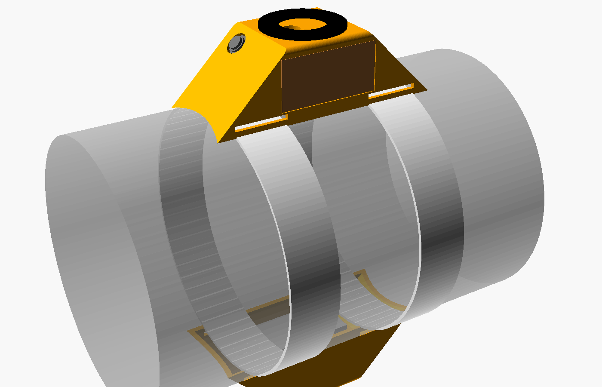
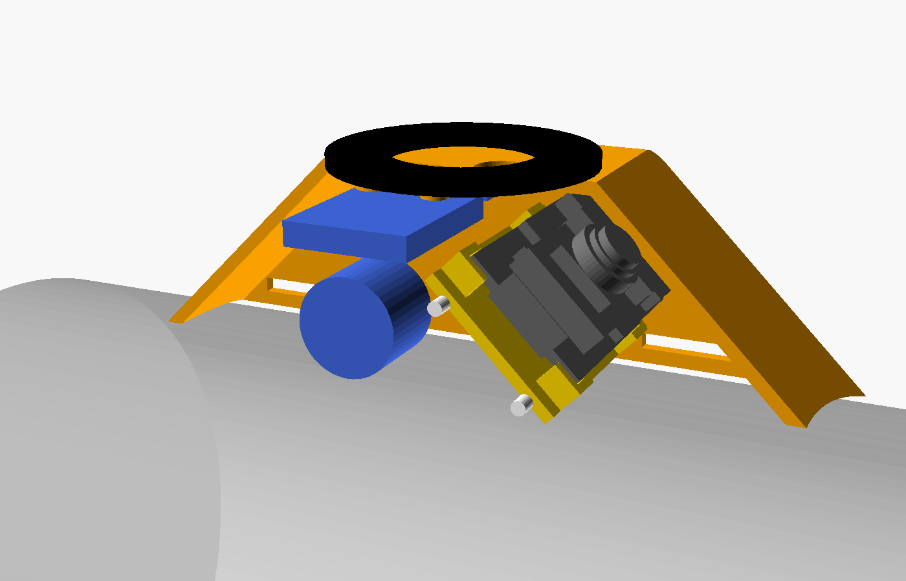

# Cintura portaelettronica 🎽

Due pod stampati, fissati alla bottiglia in pressione da due giri di elastico, uno di
fronte all'altro:

| Pod | Contenuto |
|---|---|
| **Elettronica** | XIAO ESP32-S3 Sense su slitta, camera inclinata di 45° verso l'ugello, MPU6050 e BMP180 sul soffitto, cicalino sul fianco, anello LED sul tetto, antenna fuori sul fianco opposto |
| **Batteria** | LiPo 602040 in una tasca, connettori JST davanti |

Fuori i due pod hanno la **stessa sagoma**, così frenano uguale ai due lati e non
fanno curvare il razzo. Anche i pesi sono vicini: circa 32 g il lato elettronica,
circa 29 g quello batteria.

Gli STL già esportati sono in [stl/](stl/), con le misure provvisorie qui sotto.

Il modello è parametrico: [cintura.scad](cintura.scad), da aprire con **OpenSCAD**
(versione Nightly consigliata, molto più veloce). Tutte le misure si cambiano dal
pannello *Customizer*, senza toccare il codice.

## Aprire il modello

1. Apri `cintura.scad` con OpenSCAD e premi **F5** (anteprima): all'apertura OpenSCAD
   carica il file ma non lo disegna da solo.
2. **Finestra → Customizer**: è il pannello con tutte le misure e la scelta della
   `parte` da vedere. Ogni modifica ridisegna il modello.
3. L'editor del codice si può chiudere (✕ sul pannello *Editor*) per avere più spazio.
4. A ogni anteprima la vista torna sul pezzo. Per ruotare liberamente togli
   `inquadratura_automatica`.

## Prima di stampare: misure da inserire

Le misure **provvisorie** sono quelle di default. Vanno sostituite con quelle vere:

| Parametro | Default | Come misurarlo |
|---|---|---|
| `diametro_bottiglia` | 104 | Circonferenza della parte dritta con una striscia di carta, divisa per 3,1416 |
| `elastico_larghezza` / `elastico_spessore` | 20 / 1,2 | Calibro, elastico non teso |
| `quota_faccia` | 11,4 | Distanza dal fondo della XIAO alla cima del flat arancione della camera, + 0,3 |
| `batteria_*` | 42 × 20 × 6 | Calibro sulla cella arrivata (si gonfiano un po' da cariche) |

Le altre misure vengono dal modello 3D ufficiale Seeed (XIAO), dalle schede dei moduli e
dalle tue foto (anello, MPU6050, BMP180, cicalino, antenna).

## Stampa

- **PETG** (il PLA al sole si deforma). Strato 0,2 mm, **4 perimetri** (= parete da
  1,6 mm piena), riempimento 30%.
- **Niente supporti**: i pod si stampano **capovolti, col tetto sul piatto** (i file e
  l'opzione `parte` li danno già orientati), la slitta in piano.
- Filamento **non trasparente**: il BMP180 è sensibile alla luce.
- Esportazione: `parte` → `pod_elettronica`, `pod_batteria`, `slitta` (o
  `stampa_tutto`), poi *Render* (F6) ed *Export STL*.

| Parte | Peso stimato |
|---|---|
| Pod elettronica | 13 g |
| Pod batteria | 18,5 g |
| Slitta | 1,2 g |

## Materiale

- 2 spezzoni di **filamento da 1,75 mm** lunghi 35 mm (perni della slitta)
- 2 spezzoni di filamento da 1,75 o 2 viti M2 (anello LED)
- 3 **viti autofilettanti M2.5 × 5** (2 per l'MPU6050, 1 per il BMP180); con M2 metti
  `foro_vite = 1.6`
- Striscia di **camera d'aria di bici** (~0,8 mm) da incollare sotto i bordi dei pod
- **Elastico** bianco piatto, due pezzi
- Nastro adesivo trasparente, un pezzetto di spugna

## Montaggio del pod elettronica

1. **XIAO sulla slitta**: la scheda appoggia sui quattro distanziali d'angolo, dentro i
   bordini. Sotto, nei 2,2 mm di spazio, passano i fili della batteria saldati ai pad
   BAT. Una goccia di colla a caldo su un bordino la tiene durante il montaggio.
2. **Slitta nel pod**: infilala dal fondo aperto facendola scorrere **parallela alla
   faccia inclinata**, poi spingila contro la faccia finché l'obiettivo entra nel foro.
3. **Perni**: dal fianco con l'apertura USB infila i due spezzoni da 35 mm. Passano
   dietro la slitta, nelle sue gole, e finiscono nei fori ciechi del fianco opposto.
   Per smontare si sfilano e si fa il percorso al contrario.
4. **MPU6050** sul soffitto: due viti sul lato dei fori. Il lato dei pin è verso la
   XIAO, i componenti sono verso la bottiglia. Va fissato rigido.
5. **BMP180** sul soffitto accanto: dorso liscio contro gli appoggi, una vite. Il
   sensore guarda la bottiglia, quindi va **coperto con un pezzetto di spugna**
   (dal fondo trasparente entra luce). Se il foro del tuo modulo cade sull'altro
   angolo, giralo.
6. **Cicalino** nella coppa sul fianco, col foro del suono contro il foro della parete,
   **senza l'adesivo** "remove seal". Una goccia di colla.
7. **Anello LED** sul tetto: i due fori dell'anello sui due fori del tetto, filamento
   ribattuto col saldatore (o viti M2). I fili scendono dal foro centrale, che poi va
   chiuso con una goccia di colla a caldo.
8. **Antenna** fuori, nella sua sede sul fianco senza aperture, col cavetto che entra dal
   foro centrale. Sopra, **nastro trasparente**.

La guida ai collegamenti elettrici è [cablaggio.md](../../cablaggio.md).

## Pod batteria

La cella entra dal fondo nella sua tasca, con **la protezione (PCM) e i fili verso
l'ogiva**: al decollo la cella spinge verso l'ugello e il carico deve finire sul fondo
della cella, non sulla schedina. I connettori stanno nello spazio davanti. Una volta
sulla bottiglia, l'elastico passa sotto la cella e la spinge contro le mensole.

**Cavo fra i due pod**: dai pad BAT della XIAO esce dalla finestra anteriore, corre
sulla bottiglia **sotto l'elastico anteriore** ed entra nella finestra anteriore del pod
batteria. Servono circa **20–22 cm**: **non accorciare il pigtail**.

## Sulla bottiglia

- **Posizione**: sulla bottiglia in pressione, il più in alto possibile (subito sotto il
  tratto dell'ogiva), con i pod **in mezzo fra due alette**.
- **Orientamento**: il muso verso l'ogiva, la faccia della camera verso l'ugello.
- **Elastico**: due pezzi. Ognuno passa nelle due finestre di un pod, gira intorno alla
  bottiglia, passa nelle finestre dell'altro e si chiude cucito o annodato.
  Tensione: allungato del 20–30%.
- **Gomma** sotto i bordi: aumenta l'attrito. Al decollo (~60 g) ogni pod spinge verso
  l'ugello con circa 2 kg di forza.
- **Fermo**: qualche giro di nastro telato sulla bottiglia, appena sotto i pod.
- In pressione la bottiglia si allarga di qualche millimetro: l'elastico lo assorbe.

## Prima del volo

- [ ] Nastro sull'**apertura USB/microSD** (in volo non deve entrare aria)
- [ ] Spugna sul BMP180, antenna coperta di nastro
- [ ] Pod elettronica rivolto verso chi controlla il lancio: sulla rampa la bottiglia
      è piena d'acqua e l'acqua assorbe il WiFi
- [ ] Elastici tesi, pod che non si muovono a mano

## Controlli nel modello

L'opzione `verifica` del Customizer genera l'intersezione fra il pod e i componenti
modellati. Il risultato deve essere vuoto, oppure a volume zero se i pezzi si
appoggiano soltanto:

| `verifica` | Cosa controlla |
|---|---|
| `componenti` | XIAO, slitta, sensori e antenna non entrano nelle pareti |
| `estrazione_slitta` | La slitta con la XIAO esce senza urtare niente |
| `batteria` | La cella sta nella tasca |
| `quote` | Stampa nella console le posizioni calcolate |

Con `parte = spaccato` si vede il pod elettronica aperto, con tutto montato dentro.

## Da verificare con la prima stampa

- Allineamento dell'obiettivo nel foro: il modello Seeed monta l'OV2640, il clone ha
  l'OV3660. Se non entra, cambia `quota_faccia` o `diametro_foro_obiettivo`.
- Gioco dei perni e della slitta.
- Appoggio dei bordi sulla bottiglia vera.
