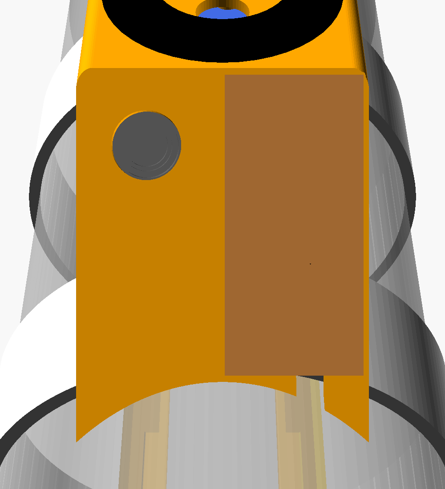
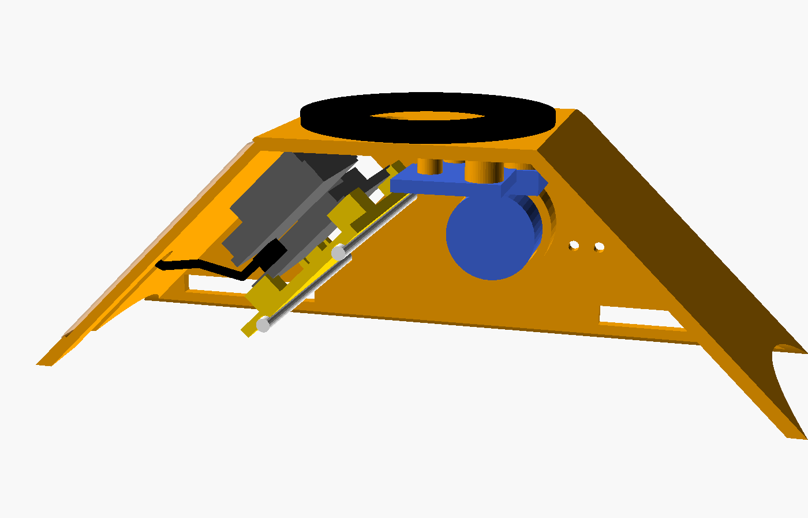

# Cintura portaelettronica 🎽

Due pod stampati, fissati alla bottiglia in pressione da due giri di elastico, uno di
fronte all'altro:

| Pod | Contenuto |
|---|---|
| **Elettronica** | XIAO ESP32-S3 Sense su slitta, camera inclinata di 45° verso l'ugello, MPU6050 e BMP180 sul soffitto, cicalino sul fianco, anello LED sul tetto, antenna fuori sulla faccia della camera, accanto all'obiettivo |
| **Batteria** | LiPo 602040 in una tasca, connettori JST davanti |

Fuori i due pod hanno la **stessa sagoma**, così frenano uguale ai due lati e non
fanno curvare il razzo. Anche i pesi sono vicini: circa 34 g il lato elettronica,
circa 32 g quello batteria.

Gli STL già esportati sono in [stl/](stl/), per la bottiglia da Ø 65 mm e l'elastico da
20 × 2 mm; le altre misure sono quelle qui sotto.

Il modello è parametrico: [cintura.scad](cintura.scad), da aprire con **OpenSCAD**
(versione Nightly consigliata, molto più veloce). Tutte le misure si cambiano dal
pannello *Customizer*, senza toccare il codice.

## Aprire il modello

1. Apri `cintura.scad` con OpenSCAD e premi **F5** (anteprima): all'apertura OpenSCAD
   carica il file ma non lo disegna da solo.
2. **Finestra → Customizer**: è il pannello con tutte le misure e la scelta della
   `parte` da vedere. Ogni modifica ridisegna il modello.
3. L'editor del codice si può chiudere (✕ sul pannello *Editor*) per avere più spazio.
4. A ogni anteprima la vista torna sul pezzo. Per ruotare liberamente togli
   `inquadratura_automatica`.

## Prima di stampare: misure da inserire

Bottiglia, elastico e antenna sono già misurati. Le altre misure di default sono
**provvisorie** e vanno sostituite con quelle vere:

| Parametro | Default | Come misurarlo |
|---|---|---|
| `diametro_bottiglia` | 65 (misurato) | Circonferenza della parte dritta con una striscia di carta, divisa per 3,1416 |
| `elastico_larghezza` / `elastico_spessore` | 20 / 2 (misurato) | Calibro, elastico non teso |
| `quota_faccia` | 11,4 | Distanza dal fondo della XIAO alla cima del flat arancione della camera, + 0,3 |
| `antenna_lunghezza` / `antenna_larghezza` | 37 × 17 (misurata) | Calibro |
| `antenna_attacco` / `antenna_attacco_lato` | 13,7 / 10,5 (dalla foto) | Antenna dal lato saldato, saldatura in basso: dal bordo corto in basso e dal bordo lungo di destra al centro della saldatura |
| `batteria_*` | 42 × 20 × 6 | Calibro sulla cella arrivata (si gonfiano un po' da cariche) |

Le altre misure vengono dal modello 3D ufficiale Seeed (XIAO), dalle schede dei moduli e
dalle tue foto (anello, MPU6050, BMP180, cicalino, antenna).

## Stampa

- **PETG** (il PLA al sole si deforma). Strato 0,2 mm, **4 perimetri** (= parete da
  1,6 mm piena), riempimento 30%.
- **Niente supporti**: i pod si stampano **capovolti, col tetto sul piatto** (i file e
  l'opzione `parte` li danno già orientati), la slitta in piano.
- Filamento **non trasparente**: il BMP180 è sensibile alla luce.
- Esportazione: `parte` → `pod_elettronica`, `pod_batteria`, `slitta` (o
  `stampa_tutto`), poi *Render* (F6) ed *Export STL*.

| Parte | Peso stimato |
|---|---|
| Pod elettronica | 15 g |
| Pod batteria | 21 g |
| Slitta | 1,2 g |

## Materiale

- 2 spezzoni di **filamento da 1,75 mm** lunghi 35 mm (perni della slitta)
- 2 spezzoni di filamento da 1,75 o 2 viti M2 (anello LED)
- 3 **viti autofilettanti M2.5 × 5** (2 per l'MPU6050, 1 per il BMP180); con M2 metti
  `foro_vite = 1.6`
- Striscia di **camera d'aria di bici** (~0,8 mm) da incollare sotto i bordi dei pod
- **Elastico** bianco piatto da 20 × 2 mm, due pezzi
- Nastro adesivo trasparente, un pezzetto di spugna

## Montaggio del pod elettronica

L'animazione passo passo è in [montaggio.html](montaggio.html): aprila col browser (serve
internet per caricare la libreria 3D). Dopo una modifica al modello si rigenera con
`python montaggio.py`.

Le saldature si fanno tutte prima, al banco, come in
[cablaggio.md](../../cablaggio.md) §8: fili con circa 5 cm di abbondanza, e quelli
dell'anello LED passati dal foro del tetto prima di saldarli alla XIAO.

1. **Antenna sulla XIAO**, prima di tutto il resto. Il connettore U.FL è sulla scheda
   principale, **sotto la scheda della camera** (Sense), vicino al bordo opposto
   all'USB-C: si raggiunge solo con la Sense tolta. Togli la Sense, innesta lo spinotto
   (premi prima da un lato, poi dall'altro) e giralo in modo che il cavetto esca dal
   **lato lungo più vicino al connettore**, quello dei pin D0–D6: lo spinotto ruota sul
   connettore. Nel pod quel lato sta in basso, verso la bottiglia. Poi rimetti la Sense.
2. **XIAO sulla slitta**: la scheda appoggia sui quattro distanziali d'angolo, dentro i
   bordini. Sotto, nei 2,2 mm di spazio, passano i fili della batteria saldati ai pad
   BAT. Una goccia di colla a caldo su un bordino la tiene durante il montaggio.
3. **Slitta nel pod**: infilala dal fondo aperto facendola scorrere **parallela alla
   faccia inclinata**, poi spingila contro la faccia finché l'obiettivo entra nel foro.
   L'antenna resta fuori dal fondo aperto.
4. **Perni**: due spezzoni di filamento da 1,75 mm lunghi 35 mm, tagliati dalla bobina
   col tronchesino (non si stampano). Smussa le punte con la carta vetrata. Dal fianco
   con l'apertura USB infilali: passano dietro la slitta, nelle sue gole, e finiscono nei
   fori ciechi del fianco opposto. Entrano con un po' di gioco: in volo li tiene il nastro
   dell'apertura USB, che copre anche le loro teste. Niente colla, devono potersi sfilare.
5. **MPU6050** sul soffitto: due viti sul lato dei fori. Il lato dei pin è verso la
   XIAO, i componenti sono verso la bottiglia. Va fissato rigido.
6. **BMP180** sul soffitto accanto: dorso liscio contro gli appoggi, una vite. Il
   sensore guarda la bottiglia, quindi va **coperto con un pezzetto di spugna**
   (dal fondo trasparente entra luce). Se il foro del tuo modulo cade sull'altro
   angolo, giralo.
7. **Cicalino** nella coppa sul fianco, col foro del suono contro il foro della parete,
   **senza l'adesivo** "remove seal". Una goccia di colla.
8. **Anello LED** sul tetto: i due fori dell'anello sui due fori del tetto, filamento
   ribattuto col saldatore (o viti M2). I fili scendono dal foro centrale, che poi va
   chiuso con una goccia di colla a caldo.
9. **Antenna** fuori, nella sua sede sulla **faccia della camera, accanto
   all'obiettivo**. Infila il cavetto nella **fessura** della faccia dal basso, dal
   bordo che poggia sulla bottiglia, e fallo salire fino in cima. L'antenna va col
   **lato saldato contro la faccia e la saldatura in basso**, così la saldatura entra
   nella fessura; il lato adesivo resta verso l'esterno, con la sua pellicola. Sopra
   metti il **nastro trasparente**, che chiude anche la fessura, senza coprire il foro
   dell'obiettivo. Il percorso usa circa 1,6 cm dei 3 cm di cavetto: quello che avanza
   fa un'ansa morbida sotto la scheda, senza pieghe strette (è un coassiale).

**Smontare**: togli il nastro, stacca l'antenna e fai scendere il cavetto lungo la
fessura fino al bordo della faccia. Poi sfila i perni ed estrai la slitta facendo il
percorso al contrario: l'antenna esce insieme alla XIAO, senza staccare lo spinotto.

La guida ai collegamenti elettrici è [cablaggio.md](../../cablaggio.md).

## Pod batteria

La cella entra dal fondo nella sua tasca, con **la protezione (PCM) e i fili verso
l'ogiva**: al decollo la cella spinge verso l'ugello e il carico deve finire sul fondo
della cella, non sulla schedina. I connettori stanno nello spazio davanti. Una volta
sulla bottiglia, l'elastico passa sotto la cella e la spinge contro le mensole.

**Cavo fra i due pod**: dai pad BAT della XIAO esce dalla finestra anteriore, corre
sulla bottiglia **sotto l'elastico anteriore** ed entra nella finestra anteriore del pod
batteria. Servono circa **20–22 cm**: **non accorciare il pigtail**.

## Sulla bottiglia

- **Posizione**: sulla bottiglia in pressione, il più in alto possibile (subito sotto il
  tratto dell'ogiva), con i pod **in mezzo fra due alette**.
- **Orientamento**: il muso verso l'ogiva, la faccia della camera verso l'ugello.
- **Elastico**: due pezzi. Ognuno passa nelle due finestre di un pod, gira intorno alla
  bottiglia, passa nelle finestre dell'altro e si chiude cucito o annodato.
  Tensione: allungato del 20–30%.
- **Gomma** sotto i bordi: aumenta l'attrito. Al decollo (~60 g) ogni pod spinge verso
  l'ugello con circa 2 kg di forza.
- **Fermo**: qualche giro di nastro telato sulla bottiglia, appena sotto i pod.
- In pressione la bottiglia si allarga di qualche millimetro: l'elastico lo assorbe.

## Prima del volo

- [ ] Nastro sull'**apertura USB/microSD** e sulle teste dei perni (in volo non deve
      entrare aria e i perni non devono sfilarsi)
- [ ] Spugna sul BMP180, antenna e fessura del cavetto coperte di nastro, foro
      dell'obiettivo libero
- [ ] Pod elettronica rivolto verso chi controlla il lancio: sulla rampa la bottiglia
      è piena d'acqua e l'acqua assorbe il WiFi
- [ ] Elastici tesi, pod che non si muovono a mano

## Controlli nel modello

L'opzione `verifica` del Customizer genera l'intersezione fra il pod e i componenti
modellati. Il risultato deve essere vuoto, oppure a volume zero se i pezzi si
appoggiano soltanto:

| `verifica` | Cosa controlla |
|---|---|
| `componenti` | XIAO, slitta, sensori, antenna e cavetto non entrano nelle pareti; il cavetto non tocca XIAO e slitta |
| `estrazione_slitta` | La slitta con la XIAO esce senza urtare niente |
| `batteria` | La cella sta nella tasca |
| `quote` | Stampa nella console le posizioni calcolate |

Con `parte = spaccato` si vede il pod elettronica aperto, con tutto montato dentro;
con `spaccato_antenna` lo si vede di fianco, senza la parete, con il percorso del cavetto
dell'antenna.

Il tetto si alza da solo quanto basta perché l'antenna stia sulla faccia accanto
all'obiettivo (ora di 2,4 mm): il fondo della faccia segue la bottiglia ed è più basso
ai lati che al centro. La console lo scrive a ogni anteprima.

## Da verificare con la prima stampa

- Allineamento dell'obiettivo nel foro: il modello Seeed monta l'OV2640, il clone ha
  l'OV3660. Se non entra, cambia `quota_faccia` o `diametro_foro_obiettivo`.
- Gioco dei perni e della slitta.
- Appoggio dei bordi sulla bottiglia vera.
- Saldatura dell'antenna nella fessura: la sua posizione viene dalla foto Seeed. Se non
  ci cade, misurala e cambia `antenna_attacco` e `antenna_attacco_lato`.
- Portata del WiFi con l'antenna sulla faccia (prova di distanza a terra).
