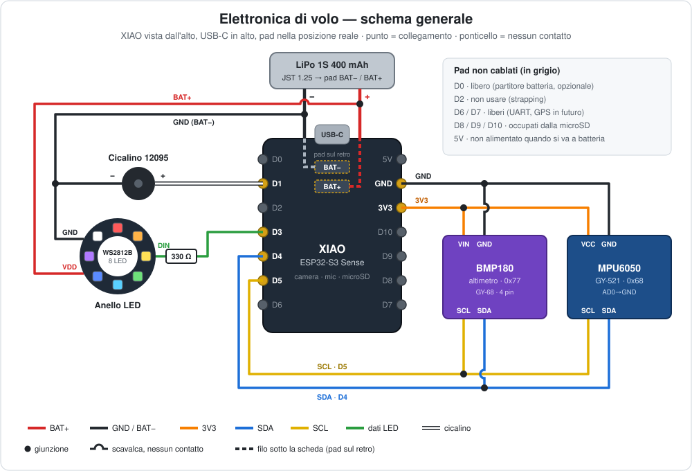
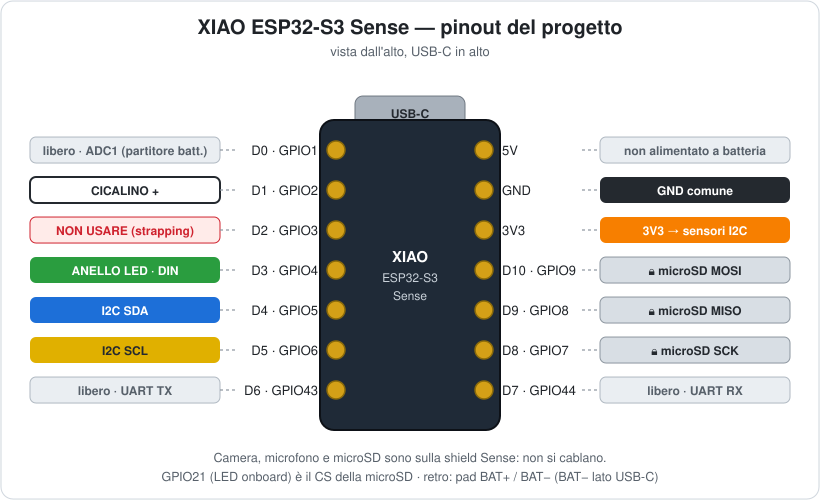
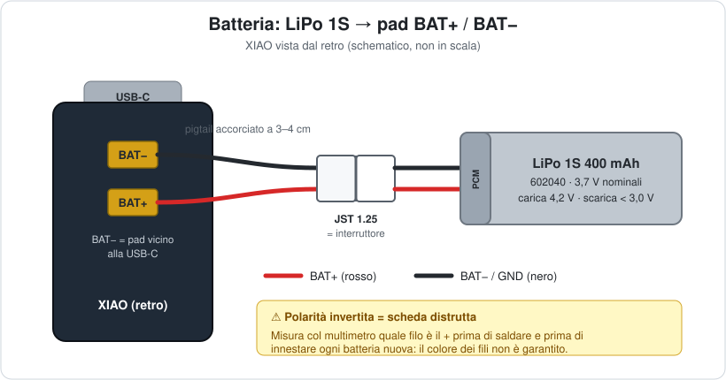
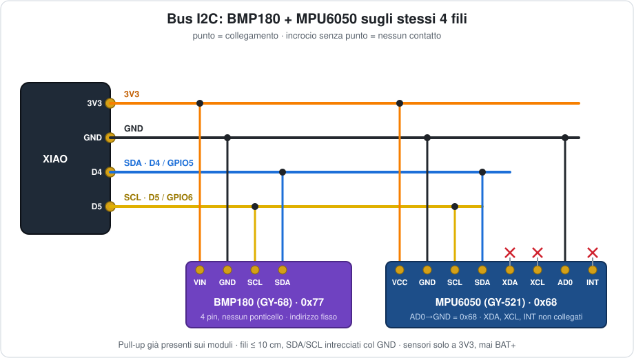
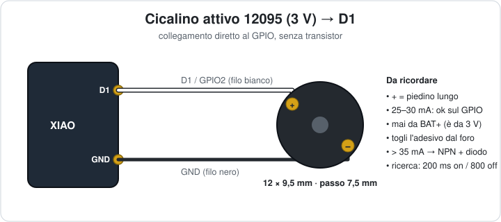
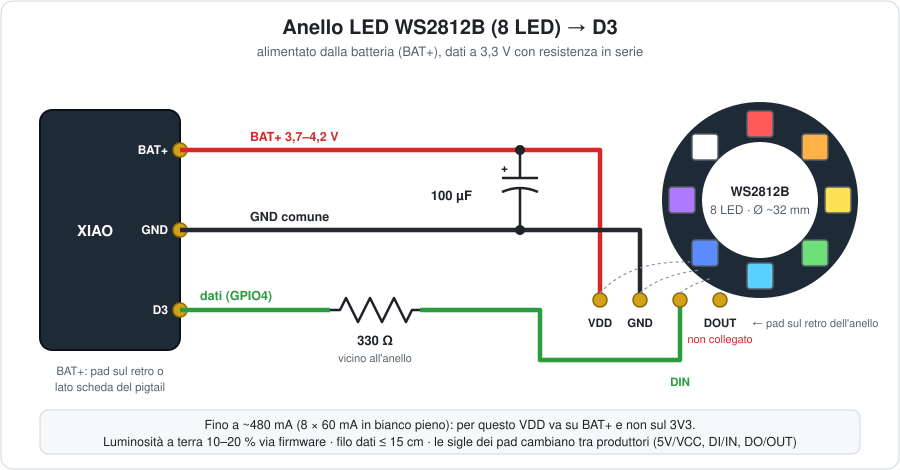

# Cablaggio dell'elettronica di volo 🔌

Guida pratica per collegare alla **XIAO ESP32-S3 Sense** la batteria, i sensori I2C
(BMP180 + MPU6050), il cicalino di ritrovamento e l'anello LED WS2812B.

Le scelte dei componenti e il perché sono in [WaterRocket.md §13–15](WaterRocket.md#13-elettronica-di-bordo-);
qui c'è il **come**: pin, fili, ordine di montaggio e collaudo.

## Indice

1. [Schema generale](#1-schema-generale)
2. [Componenti e attrezzi](#2-componenti-e-attrezzi)
3. [Pinout della XIAO](#3-pinout-della-xiao)
4. [Alimentazione e batteria](#4-alimentazione-e-batteria)
5. [Bus I2C: BMP180 + MPU6050](#5-bus-i2c-bmp180--mpu6050)
6. [Cicalino di ritrovamento](#6-cicalino-di-ritrovamento)
7. [Anello LED WS2812B (8 LED)](#7-anello-led-ws2812b-8-led)
8. [Montaggio passo-passo](#8-montaggio-passo-passo)
9. [Collaudo](#9-collaudo)
10. [Checklist prima del volo](#10-checklist-prima-del-volo)

---

## 1. Schema generale



I pad della XIAO sono disegnati **nella posizione reale** (vista dall'alto, USB-C in
alto): a sinistra D0–D6, a destra 5V, GND, 3V3, D10–D7. BAT+/BAT− sono sul retro.

Riepilogo dei collegamenti:

| Da (XIAO) | A | Note |
|---|---|---|
| **3V3** | VIN del BMP180, VCC dell'MPU6050 | Mai la tensione di batteria sui sensori |
| **GND** | GND di tutti i moduli | Massa comune, unica |
| **D4 / GPIO5** | SDA di BMP180 e MPU6050 | Bus I2C condiviso |
| **D5 / GPIO6** | SCL di BMP180 e MPU6050 | Bus I2C condiviso |
| **D1 / GPIO2** | + del cicalino (− a GND) | Diretto, ~25–30 mA |
| **D3 / GPIO4** | DIN dell'anello, tramite **330 Ω** | Segnale dati WS2812B |
| **BAT+** | VDD / 5V dell'anello | L'anello prende corrente dalla LiPo, non dal 3V3 |
| **BAT+ / BAT−** | LiPo (pigtail JST 1.25) | ⚠️ BAT− è il pad **vicino alla USB-C** |

---

## 2. Componenti e attrezzi

| Componente | Q.tà | Riferimento BOM |
|---|---|---|
| XIAO ESP32-S3 Sense (con camera e microSD) | 1 | §14 riga 1 |
| LiPo 1S 400 mAh 602040, JST 1.25, con PCM | 1 | §14 riga 2 |
| Pigtail JST 1.25 (controparte del connettore della cella) | 1 | §14 riga 6 |
| BMP180, modulo GY-68 (va bene anche un BMP280) | 1 | BMP280 in possesso |
| MPU6050 / GY-521 | 1 | §14 riga 3 |
| Cicalino attivo 12095, 3 V | 1 | §14 riga 4 |
| Anello WS2812B 8 LED | 1 | — |
| Resistenza 330 Ω (220–470 Ω va bene) | 1 | kit LED/resistenze, §14 riga 5 |
| Condensatore 100 µF ≥ 6,3 V (elettrolitico) | 1 | consigliato, vedi §7 |
| Filo sottile 28–30 AWG (silicone) | ~1 m | colori diversi |
| Guaina termorestringente | — | — |

**Attrezzi:** saldatore a punta fine, stagno, flussante, multimetro, pinzette,
nastro biadesivo spesso, un pezzetto di spugna (copre il BMP180).

💡 **Convenzione dei colori** (da rispettare, aiuta tantissimo nel debug):
rosso = BAT+, arancio = 3V3, nero = GND, blu = SDA, giallo = SCL,
verde = dati LED, bianco = cicalino.

---

## 3. Pinout della XIAO



| Pad | GPIO | Uso in questo progetto |
|---|---|---|
| D0 | 1 | libero (riservato al partitore batteria, opzionale) |
| **D1** | 2 | **cicalino** |
| D2 | 3 | ⚠️ non usare (strapping + ambiguità SD_CS, vedi §13) |
| **D3** | 4 | **dati anello LED** |
| **D4** | 5 | **I2C SDA** |
| **D5** | 6 | **I2C SCL** |
| D6 / D7 | 43 / 44 | liberi (UART, GPS in futuro) |
| D8 / D9 / D10 | 7 / 8 / 9 | 🔒 microSD |
| — | 21 | 🔒 CS microSD (il LED onboard non si può usare) |
| — | 0 | pulsante BOOT (avvio/stop registrazione nel firmware) |

Camera, microfono e microSD sono già collegati sulla shield Sense: **non si cablano**.

---

## 4. Alimentazione e batteria

### Collegamento della LiPo



La XIAO non ha connettore batteria, solo i due **pad BAT+ / BAT−** sul retro. Si salda
sui pad un pigtail JST 1.25 (la **controparte** del connettore della cella), così le
batterie si scambiano in campo senza saldare.

1. **Non accorciare il pigtail**: la batteria sta nel pod opposto della cintura
   ([3dModels/cintura](3dModels/cintura/README.md)) e fra pad e connettore servono
   ~20–22 cm. Se il pigtail più il cavo della cella non bastano, allungalo con filo
   da 28 AWG.
2. **Prima di saldare**, innesta il pigtail sulla cella e misura col multimetro quale
   filo è il +. Il colore non basta: rosso = + è una convenzione, non una garanzia.
3. Stagna i pad, poi salda: **BAT− = pad vicino alla USB-C**, BAT+ = pad lontano.
4. Guaina termorestringente su ogni filo, poi fissa il cavo alla board con una goccia
   di colla a caldo per evitare che le vibrazioni lo strappino dai pad.

> ⚠️ **Un'inversione di polarità distrugge la board.** Ricontrolla prima di ogni
> primo innesto di una batteria nuova.

### Accensione e spegnimento

Non c'è interruttore: **la XIAO si accende quando innesti la batteria** e si spegne
quando la stacchi. Il connettore JST fa da interruttore. A fine sessione la batteria
va **sempre staccata**: l'anello LED assorbe ~0,5–1 mA per LED anche spento
(~5–8 mA in tutto) e scaricherebbe la cella in un paio di giorni.

Con la batteria collegata e la USB-C inserita la XIAO **ricarica la LiPo** (50 mA,
~9–10 h per 400 mAh, vedi §13).

### Bilancio delle correnti

| Utenza | Alimentata da | Corrente tipica | Picco |
|---|---|---|---|
| XIAO + camera + WiFi + SD | LiPo → regolatore interno | ~150–250 mA | ~500 mA |
| BMP180 + MPU6050 | 3V3 | ~4 mA | ~4 mA |
| Cicalino (200 ms on / 800 off) | GPIO D1 | ~5 mA medi | ~30 mA |
| Anello WS2812B 8 LED | **BAT+** diretto | 5–100 mA (dipende dal firmware) | **~480 mA** (tutto bianco al 100 %) |

Con la luminosità limitata via firmware (§7) la batteria da 400 mAh dura comunque
**oltre un'ora** di sessione, cioè decine di lanci.

---

## 5. Bus I2C: BMP180 + MPU6050

I due sensori stanno sugli **stessi due fili** (SDA e SCL), con indirizzi diversi.

### BMP180 (altimetro)

Il modulo GY-68 ha 4 pin: `VIN GND SCL SDA`. Ha un regolatore da 3,3 V a bordo (la
sigla "662K") e l'indirizzo è fisso: **nessun ponticello** da fare.

| Pin BMP180 | Collegare a | Perché |
|---|---|---|
| VIN | **3V3** della XIAO | Attraverso il regolatore del modulo al chip arrivano ~3,1 V, dentro specifica (1,8–3,6 V) |
| GND | GND | |
| SCL | D5 (GPIO6) | |
| SDA | D4 (GPIO5) | |

Indirizzo **0x77**, non modificabile: nessun conflitto con l'MPU6050 (0x68).

> **Va bene anche un BMP280** (i 5 dell'inventario): il firmware riconosce da solo quale
> dei due c'è. Il modulo BMP280 ha 6 pin, `VCC GND SCL SDA CSB SDO`: VCC a **3V3** (molti
> breakout non hanno regolatore, mai 5 V o BAT+), **CSB a 3V3** (modo I2C) e **SDO a GND**
> (indirizzo 0x76). Rispetto al BMP180 è meno rumoroso (~0,1 m contro ~0,15 m dopo il
> filtro del firmware), ma per un apogeo di 50 m vanno bene tutti e due.

### MPU6050 / GY-521 (accelerometro + giroscopio)

Il GY-521 ha 8 pin: `VCC GND SCL SDA XDA XCL AD0 INT`.

| Pin GY-521 | Collegare a | Perché |
|---|---|---|
| VCC | **3V3** della XIAO | Il modulo ha un suo regolatore e funziona anche a 3,3 V |
| GND | GND | |
| SCL | D5 (GPIO6) | |
| SDA | D4 (GPIO5) | |
| AD0 | GND (o lasciato libero: ha pull-down) | Indirizzo **0x68**. A 3V3 → 0x69, da fare se si aggiunge il DS3231 (anche lui 0x68) |
| XDA / XCL | non collegati | Bus ausiliario per magnetometri esterni |
| INT | non collegato | Opzionale: interrupt "dato pronto" (se servirà, su D0) |

### Come cablarli



- **Fili corti** (≤ 10 cm) e SDA/SCL **intrecciati** con il GND: in volo le
  vibrazioni e i disturbi della radio WiFi sono il primo nemico dell'I2C.
- **Pull-up:** entrambi i moduli hanno già le resistenze di pull-up a bordo, non
  aggiungerne altre.
- **L'MPU6050 va fissato rigidamente** (biadesivo spesso o vite), con l'asse **Z
  allineato all'asse del razzo**: se balla dentro la spugna misura le sue vibrazioni,
  non quelle del razzo. Il BMP180 invece va **protetto dal flusso d'aria diretto**
  (un pezzetto di spugna sopra il sensore) ma in un vano **non sigillato**,
  altrimenti non sente la variazione di pressione. Il forellino sul coperchio
  metallico del chip va lasciato libero (spugna appoggiata, mai colla) e al buio:
  il BMP180 è **sensibile alla luce**, quindi niente vano in plastica trasparente.
  Va anche **fissato senza forzature** (biadesivo o alloggiamento morbido, niente vite
  che fletta il modulo): sul banco, maneggiando la breadboard, la quota saltava di
  3–5 m per un secondo. Il firmware prende la quota 0 solo a razzo fermo, quindi
  questi disturbi non entrano nella misura, ma in volo il sensore deve stare tranquillo.
- La camera usa un suo bus (SCCB su GPIO39/40): **nessun conflitto** con questo I2C.

Nel firmware il bus si apre con `Wire.begin(5, 6)` (sono anche i pin di default
della XIAO, quindi basta `Wire.begin()`).

---

## 6. Cicalino di ritrovamento

**Cicalino attivo 12095, 3 V**: ha l'oscillatore interno, basta dargli tensione.

| Pin cicalino | Collegare a |
|---|---|
| **+** (piedino lungo / segno + sull'etichetta) | **D1 (GPIO2)** |
| **−** | **GND** |



- **Collegamento diretto al GPIO**, senza transistor: 25–30 mA stanno sotto il
  limite di 40 mA del pin. Nel firmware si alza la capacità di corrente del pin:
  `gpio_set_drive_capability(GPIO_NUM_2, GPIO_DRIVE_CAP_3);`
- **Polarità:** è un componente polarizzato. Al contrario non suona (e non si rompe,
  ma meglio non provarci).
- **Mai da BAT+:** è un componente da 3 V, i 4,2 V della LiPo carica sono fuori specifica.
- **Piano B** (da §13): alla prima accensione misura la corrente. Se supera i
  **35 mA**, interponi un NPN (BC337/2N2222, 1 kΩ sulla base) con diodo 1N4148 in
  antiparallelo sul cicalino.
- Togli l'**adesivo protettivo** dal foro del cicalino dopo la saldatura (serve solo
  per il lavaggio della scheda): con l'adesivo il volume cala moltissimo.
- Nel pod della cintura va nella sua coppa sul fianco, col foro del suono contro il
  foro della parete: chiuso dentro, si sentirebbe a pochi metri.

---

## 7. Anello LED WS2812B (8 LED)

### Collegamento

L'anello ha 4 pad (le sigle cambiano tra produttori):

| Pad anello | Sigle tipiche | Collegare a |
|---|---|---|
| Alimentazione | `5V` / `VCC` / `VDD` | **BAT+** (lato batteria del pigtail o pad BAT+) |
| Massa | `GND` | **GND** della XIAO |
| Ingresso dati | `DI` / `DIN` / `IN` | **D3 (GPIO4)** tramite resistenza da **330 Ω** |
| Uscita dati | `DO` / `DOUT` / `OUT` | **non collegato** (serve solo a concatenare altri LED) |



### Prove sul banco senza batteria: dal pad 5V

Finché la LiPo non c'è, l'anello si può alimentare dal pad **5V** (VUSB) con la XIAO
collegata all'USB. La corrente dei LED non passa dai GPIO né dal regolatore del 3V3.

- **Luminosità bassa**: la porta USB del PC dà ~500 mA e la XIAO ne usa già 250–500.
  In modalità prova il firmware limita l'anello al 25%.
- A 5 V la soglia del segnale dati sale a 3,5 V, sopra i 3,3 V della XIAO: spesso
  funziona lo stesso, ma se il primo LED sfarfalla metti un diodo (1N4148/1N5819) in
  serie sul 5V, che porta l'alimentazione a ~4,3 V.
- Il segnale va sul pad **DI** dell'anello (non DO: si leggono facilmente "D1"/"D0").

> ⚠️ **Quando arriva la batteria**, sposta VDD dell'anello su BAT+ e **togli il filo del
> 5V**. Con anello collegato a 5V e BAT+ insieme, l'USB finisce direttamente sulla LiPo
> scavalcando il caricatore: rischio di sovraccarica, rigonfiamento o incendio.

### Perché da BAT+ e non dal 3V3

- **Corrente:** al massimo l'anello chiede ~480 mA (8 LED × 60 mA). Sommati ai
  ~250–500 mA della XIAO con camera e WiFi, sul 3V3 si rischia di far scendere la
  tensione e riavviare la board proprio al lancio. Da BAT+ la corrente arriva
  direttamente dalla cella e il regolatore della XIAO resta tranquillo.
- **Tensione:** il WS2812B è specificato per **3,5–5,3 V**. La LiPo dà 3,7–4,2 V:
  perfetto. A 3,3 V il LED blu e il bianco perdono colore e luminosità.

### Il segnale dati a 3,3 V funziona?

Il WS2812B considera "alto" un segnale sopra **0,7 × VDD**. Con la LiPo carica (4,2 V)
la soglia è 2,94 V e la XIAO esce a 3,3 V: **funziona, con poco margine**. Per stare
tranquilli:

- **resistenza da 330 Ω in serie vicino all'anello**: smorza i rimbalzi sul filo e
  protegge il primo LED;
- **filo dati corto** (≤ 10–15 cm) e affiancato al GND;
- **massa comune** tra anello e XIAO (sempre, altrimenti il segnale non ha riferimento).

Se un giorno il primo LED sfarfalla o i colori sono casuali, la soluzione classica è un
traslatore di livello (es. 74AHCT125). Con 8 LED e fili corti in genere non serve.

### Condensatore

Il **100 µF** tra VDD e GND, saldato vicino all'anello, assorbe i picchi di corrente
quando i LED si accendono di colpo (lampeggi del ritrovamento) e protegge l'anello
all'innesto della batteria. Rispetta la polarità: la fascia col segno − va a GND.
Se non c'è spazio si può omettere, ma è il primo indiziato in caso di reset.

### Luminosità e consumi

Il consumo dipende solo dal firmware. Valori indicativi per 8 LED:

| Uso | Colore / luminosità | Corrente |
|---|---|---|
| Stato a terra | 1 colore, 10 % | ~15 mA |
| Registrazione in corso | rosso pulsante, 20 % | ~10–30 mA |
| Ritrovamento | lampo bianco 100 ms ogni secondo | ~50 mA medi |
| Visibilità in volo | bianco 100 % per pochi secondi | ~480 mA |
| Didattica (quota → colore) | 1 colore, 30 % | ~40 mA |

👉 **Regola:** luminosità massima **solo in volo e nel ritrovamento**; a terra
10–20 % (al sole si vede comunque, e non si scarica la batteria in attesa del lancio).

### Uso previsto nel firmware

| Fase | Anello | Cicalino |
|---|---|---|
| Avvio / errore | rosso fisso = SD mancante o sensori non trovati | 3 beep lunghi |
| Pronto | verde fisso, 10 % | — |
| Calibrazione pre-lancio (3 s) | blu che respira | 2 beep corti = ok, 1 lungo = fallita |
| Registrazione / armato | rosso pulsante | 1 beep corto all'avvio |
| In volo (dalla spinta all'apogeo) | bianco 100 % | — |
| Discesa | colore in base alla quota (didattica) | — |
| Atterrato / ritrovamento | lampo bianco 1 Hz | 200 ms on / 800 ms off |

Libreria consigliata: **Adafruit NeoPixel** (usa la periferica RMT dell'ESP32-S3,
libera anche con camera e microfono attivi).

```cpp
#include <Adafruit_NeoPixel.h>
Adafruit_NeoPixel ring(8, 4 /* D3 = GPIO4 */, NEO_GRB + NEO_KHZ800);

void setup() {
  ring.begin();
  ring.setBrightness(25);  // ~10 %: a terra basta e avanza
  ring.fill(ring.Color(0, 255, 0));
  ring.show();
}
```

---

## 8. Montaggio passo-passo

Prova prima tutto su **breadboard** (con la XIAO alimentata via USB-C), poi salda.
Ordine consigliato, collaudando dopo ogni passo (§9):

1. **Pigtail batteria** sui pad BAT+/BAT− (§4). Collaudo: polarità e tensione.
2. **Due fili di alimentazione** dai pad 3V3 e GND verso un piccolo "nodo" di
   distribuzione (un pezzetto di millefori o una giunzione con guaina): da lì partono
   le alimentazioni dei sensori. Meglio che saldare tre fili sullo stesso pad.
3. **BMP180**: VIN, GND, SDA, SCL, nessun ponticello (con un BMP280: CSB→3V3 e SDO→GND).
   Collaudo: scansione I2C (deve comparire 0x77; 0x76 con un BMP280).
4. **MPU6050**: VCC, GND, SDA, SCL (AD0 a GND). Collaudo: scansione I2C
   (0x68 e 0x77).
5. **Cicalino** su D1 e GND. Collaudo: beep.
6. **Anello LED**: resistenza da 330 Ω e condensatore saldati **sull'anello**, poi tre
   fili: VDD → BAT+, GND, DIN → D3. Collaudo: test colori.
7. **Sistemazione nei pod della cintura**, passo per passo in
   [3dModels/cintura/README.md](3dModels/cintura/README.md): XIAO sulla slitta,
   MPU6050 avvitato rigido, BMP180 coperto di spugna, cicalino nella sua coppa,
   anello sul tetto, antenna fuori sul fianco, LiPo nel pod opposto.

Tutte le giunzioni con **guaina termorestringente**; i fili che escono dai pad della
XIAO fissati con una goccia di colla a caldo (scarico della trazione).

---

## 9. Collaudo

### Prima di innestare la batteria (multimetro)

| Misura | Valore atteso |
|---|---|
| Resistenza BAT+ ↔ BAT− (batteria staccata) | **non** zero (nessun cortocircuito) |
| Resistenza 3V3 ↔ GND | non zero |
| Continuità GND XIAO ↔ GND di ogni modulo e dell'anello | ~0 Ω |
| Tensione della cella sul connettore | 3,0–4,2 V, + sul filo che va a BAT+ |

### Con la XIAO accesa

| Prova | Come | Esito atteso |
|---|---|---|
| Tensione 3V3 | multimetro tra 3V3 e GND | 3,25–3,35 V |
| Tensione anello | multimetro tra VDD anello e GND | = tensione batteria |
| Bus I2C | sketch di scansione (sotto) | dispositivi **0x68** e **0x77** (0x76 con un BMP280) |
| Altimetro | comando `i` sulla seriale | `Altimetro: BMP180 ok (I2C 0x77)` |
| Quota | dati in continuo (`a`): scheda dalla scrivania al pavimento e ritorno | gradino pari all'altezza del piano (73,5 cm misurati −0,71 m); a scheda ferma ±0,3 m |
| Cicalino | `digitalWrite(2, HIGH)` | suono forte; corrente ≤ 35 mA |
| Anello | rosso, verde, blu, bianco in sequenza | 8 LED, colori corretti |
| Registrazione | `r` da seriale o pulsante BOOT | ~27 fps come prima del cablaggio |

Scansione I2C minima:

```cpp
#include <Wire.h>
void setup() {
  Serial.begin(115200);
  delay(2000);
  Wire.begin(5, 6);  // SDA = D4, SCL = D5
  for (uint8_t a = 1; a < 127; a++) {
    Wire.beginTransmission(a);
    if (Wire.endTransmission() == 0) Serial.printf("Trovato 0x%02X\n", a);
  }
}
void loop() {}
```

**Se un sensore non compare:** SDA e SCL invertiti (è l'errore più comune), saldatura
fredda, oppure modulo alimentato da 5 V e danneggiato. Con un BMP280, anche CSB non a 3V3.

L'ultima prova è importante: con camera, WiFi, sensori e anello accesi insieme la
registrazione deve restare a **~27 fps senza errori**. Se la board si riavvia quando
l'anello lampeggia, manca il condensatore o l'anello è stato collegato al 3V3.

---

## 10. Checklist prima del volo

- [ ] Batteria carica (≥ 3,9 V) e **fissata** nella sua tasca
- [ ] Polarità del pigtail verificata (batteria nuova? misurala)
- [ ] Antenna innestata, nella sua sede sul fianco e coperta di nastro
- [ ] Anello verde (pronto) → nessun errore di SD o sensori
- [ ] Razzo sulla rampa, fermo: **📏 Calibra prima del lancio** dalla webapp (o `z`
      da seriale). Non toccarlo per 3 s (anello blu), attendi i 2 beep corti e
      "✅ calibrato" con quota entro ±0,5 m. Se passano più di 10 minuti, rifalla
- [ ] Registrazione avviata (anello rosso pulsante, beep corto)
- [ ] Foro del cicalino libero, adesivo protettivo rimosso
- [ ] Slitta bloccata dai due perni, nastro sull'apertura USB, spugna sul BMP180,
      nessun filo in tensione
- [ ] Dopo il recupero: fermare la registrazione **prima** di staccare la batteria
      (oppure accettare di perdere l'ultimo secondo, vedi firmware)
- [ ] A fine giornata: **batteria staccata** e messa in carica
