<!-- _class: lead -->
<!-- _paginate: false -->
<!-- _footer: "" -->

# Razzo ad acqua<br>**intelligente!**

### Come un computer da pochi grammi sente, decide e racconta un volo

Daniele Monte · Meet and Code 2026

<!--
Benvenuti. Oggi non parliamo di programmazione «da tastiera», ma di cosa succede dentro i chip:
come un oggetto da pochi grammi riesce a sentire la pressione dell'aria, l'accelerazione, e a
raccontarci un volo che dura pochi secondi.
Non serve sapere niente di elettronica o di codice: ogni pezzo lo costruiamo da zero.
-->

---

# Il viaggio di oggi

1. **Il razzo** — cosa succede in pochi secondi
2. **Il cervello** — microcontrollore, famiglia ESP32, la scheda XIAO
3. **Quanto in alto?** — il barometro BMP180
4. **Come parlano i chip** — il bus I²C
5. **Come si muove?** — accelerometro e giroscopio
6. **Farsi trovare** — cicalino e anello LED
7. **Tutto insieme** — dal sensore al grafico sul telefono

<!--
Sette tappe. Ogni sensore lo guardiamo in due modi: il principio fisico (perché funziona)
e come «parla» con il computer di bordo. Il bus I²C lo spieghiamo una volta sola, al
barometro, e poi lo ritroviamo con l'accelerometro.
-->

---

<!-- _footer: "Foto: Xorx, CC BY-SA 4.0, Wikimedia Commons" -->

# Un razzo fatto con una bottiglia

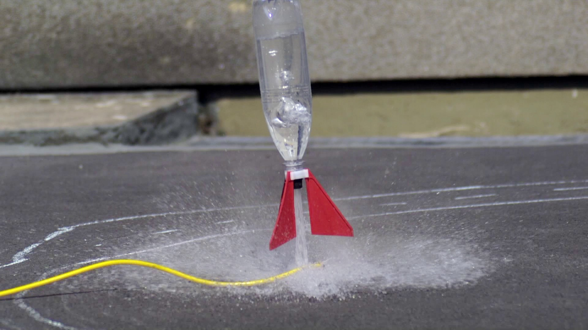

- Una bottiglia da **bibita gassata**, riempita per ⅓ d'acqua
- Si pompa **aria** fino a 5–6 bar: più del doppio di una gomma d'auto
- Si sgancia: l'aria spinge fuori l'acqua, l'acqua **spinge su il razzo**
- **Azione e reazione** (3ª legge di Newton): è lo stesso motivo per cui un palloncino lasciato andare schizza via

<!--
Il principio è lo stesso dei razzi veri: si butta via massa da una parte e si viene spinti
dall'altra. Qui la massa è l'acqua, e l'energia è nell'aria compressa.
Perché bibita gassata? Perché quelle bottiglie sono fatte per reggere la pressione dell'anidride
carbonica: sono il «serbatoio» più sicuro ed economico che esista.
Domanda al pubblico: secondo voi va più in alto con tanta acqua o con poca? (Risposta: circa
un terzo è il compromesso: poca acqua = spinta breve, troppa = razzo pesante.)
-->

---

<!-- _class: numeri -->

# Il volo in numeri

- **0,2 s** di spinta: in un attimo l'acqua è finita
- **~60 g** al decollo: un pilota di caccia ne regge 9
- **~50 m** di quota massima, come un palazzo di 16 piani
- **~100 km/h** all'arrivo a terra: niente paracadute, 6–7 s dopo il lancio

<!--
Numeri stimati con la fisica del progetto (pressione 6 bar, collo della bottiglia, massa di
circa 750 g): il primo volo con l'elettronica li verificherà.
Il razzo non ha paracadute: dall'apogeo ricade frenato solo dall'aria e tocca terra a circa
27 m/s. L'elettronica deve sopravvivere a questo, e poi farsi trovare.
«g» è l'accelerazione di gravità: 60 g vuol dire una spinta pari a 60 volte il peso del razzo.
Tutto quello che c'è di interessante succede in un tempo più breve di un battito di ciglia: per
questo serve qualcuno che guardi 100 volte al secondo.
-->

---

# Prima di tutto: sicurezza

- Aria compressa = **energia**: una bottiglia che cede a 6 bar può ferire
- Solo bottiglie per **bibite gassate**, integre, mai ammaccate
- **Occhiali** per chi pompa, tutti a **10 metri** di distanza
- Si lancia **all'aperto**, lontano da persone, alberi e fili elettrici
- Mai sopra o davanti al razzo carico, e sempre con un **adulto**

<!--
Slide breve ma da non saltare, soprattutto se poi ci sarà un lancio dimostrativo.
-->

---

<!-- _class: domanda -->

# Cosa succede davvero<br>in quei secondi?

Quanto è salito? Quanto ha accelerato? Ha girato su se stesso? Dov'è caduto?

**Mettiamo un piccolo computer a bordo.**

<!--
Lasciare qualche secondo di silenzio. Con gli occhi non riusciamo a rispondere: il razzo è
troppo veloce e troppo lontano. Serve uno strumento che misuri e registri per noi.
-->

---

# Il computer di bordo: una «cintura»


- Due **pod** stampati in 3D, uno di fronte all'altro, tenuti da elastici
- Da un lato l'**elettronica** (~34 g), dall'altro la **batteria** (~32 g)
- Fuori hanno la **stessa forma**: il razzo resta simmetrico e vola dritto
- **Niente paracadute**: i pod devono reggere l'arrivo a terra

<!--
Il modello 3D è parametrico (OpenSCAD): si cambia il diametro della bottiglia e si ristampa.
Perché due pod opposti? Se tutto il peso fosse da una parte, il razzo sarebbe sbilanciato e
curverebbe. Mettendo la batteria dall'altra parte i pesi si compensano.
-->

---

# Dentro il pod elettronica


- La scheda **XIAO**, con la camera rivolta verso il basso
- I **sensori** di pressione e di movimento
- Il **cicalino** sul fianco
- L'**anello LED** sul tetto
- Fuori, l'**antenna** WiFi

<!--
Questo è lo «spaccato» del pod: tutto deve stare in pochi centimetri cubi e resistere a 60 g.
La camera è inclinata di 45° verso l'ugello: vede la terra che si allontana.
Da qui in poi prendiamo ogni componente, uno alla volta, e ci chiediamo: come fa a funzionare?
-->

---

<!-- _class: capitolo -->

## 2
# Il cervello

il microcontrollore

---

# Che cos'è un microcontrollore?

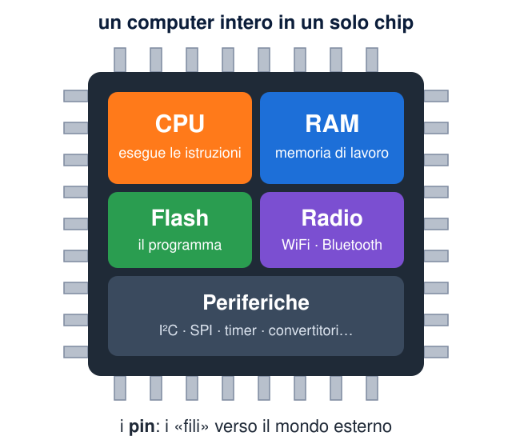

Un **computer intero in un solo chip**:

- **CPU**: esegue le istruzioni, una dopo l'altra
- **Memoria**: tiene il programma e i dati
- **Periferiche e pin**: i «sensi» e i «muscoli» verso il mondo

Fa **una cosa sola**, ma la fa sempre, senza stancarsi e senza distrarsi.

<!--
Un PC ha questi pezzi sparsi su una scheda madre: processore, banchi di RAM, disco. Un
microcontrollore li mette tutti nello stesso pezzetto di silicio, più piccolo di un'unghia.
I pin sono le «zampette» del chip: ognuno è un filo che può leggere o comandare qualcosa.
-->

---

# Computer o microcontrollore?

| | Il tuo PC | La nostra XIAO |
|---|---|---|
| Velocità | 3–5 GHz, 8 o più core | 240 MHz, 2 core |
| Memoria di lavoro | 16 GB | 8 MB: 2 000 volte meno |
| Sistema operativo | Windows, macOS, Linux | un mini-sistema e **un solo programma** |
| Consumo | 50–300 W | **meno di 1 W** |
| Peso | qualche kg | **pochi grammi** |
| Prezzo | centinaia di € | **20–30 €** |

<!--
Il microcontrollore è «scarso» in tutto, tranne in ciò che serve: è piccolo, consuma poco,
si accende in un attimo e fa sempre esattamente la stessa cosa, con tempi precisi.
Per un razzo che deve leggere i sensori 100 volte al secondo, la precisione dei tempi conta
più della potenza.
-->

---

<!-- _footer: "Foto: Phiarc · Antonio Martí Campoy — CC BY-SA 4.0, Wikimedia Commons" -->

# Sono ovunque (e non li vediamo)

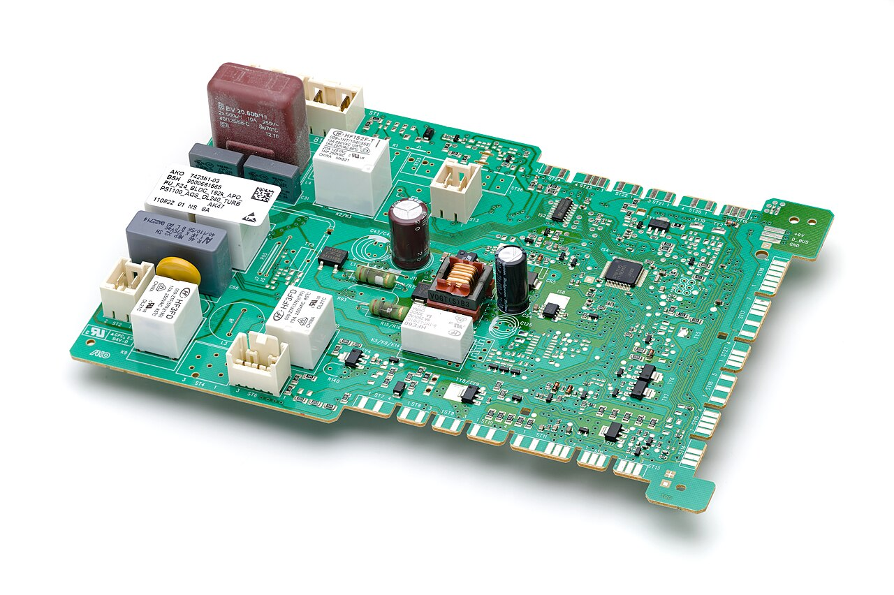
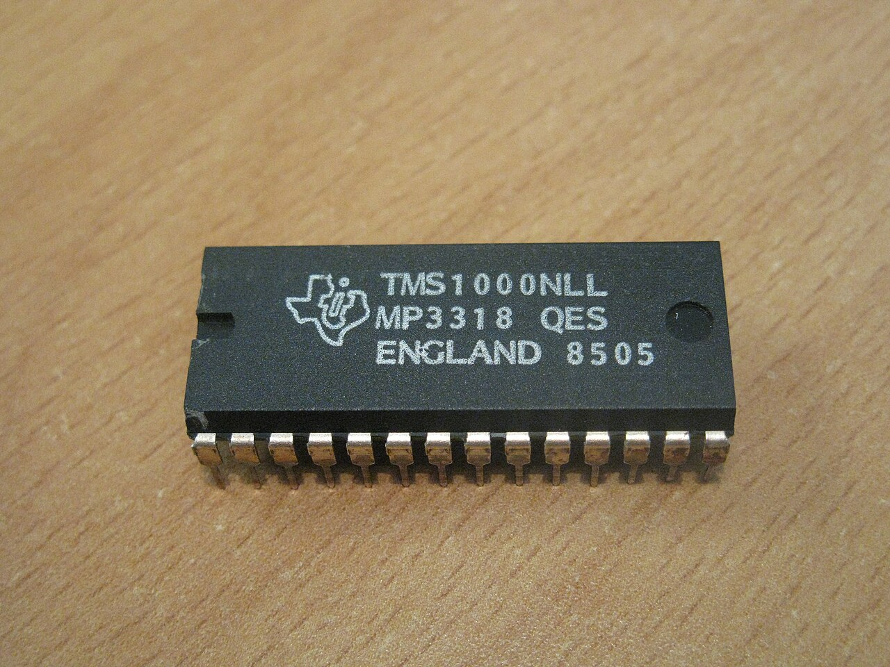

- Lavatrice, microonde, frigorifero, telecomando
- Tastiera, mouse, cuffie bluetooth, smartwatch
- Un'auto moderna ne ha **decine**, a volte più di cento
- Se ne producono **decine di miliardi** ogni anno: più di tre per ogni persona sulla Terra
- Il primo, il **TMS1000** di Texas Instruments, è degli **anni '70** (sotto)

<!--
Sopra: la scheda di comando di una lavatrice; il chip quadrato con tanti piedini è il
microcontrollore. Sotto: un TMS1000, considerato il primo microcontrollore della storia
(questo esemplare è del 1985). Finì in calcolatrici, giocattoli, forni a microonde.
Chiedere: quanti microcontrollori avete addosso in questo momento? (Telefono, ma dentro al
telefono ce ne sono diversi; auricolari; orologio; la chiave della macchina; la carta di credito
con il chip...)
-->

---

# Come ragiona: sento, decido, agisco

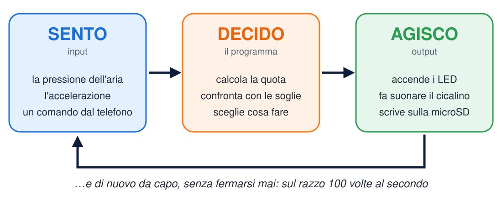

<!--
Questo è il cuore di qualsiasi programma per microcontrollore: un ciclo infinito.
Sento: leggo i sensori. Decido: confronto con delle regole. Agisco: accendo, spengo, scrivo.
Poi ricomincio. Nel nostro razzo il giro completo si ripete 100 volte al secondo.
Nel linguaggio di Arduino questo ciclo si chiama proprio loop().
-->

---

# Il linguaggio dei pin: 0 e 1

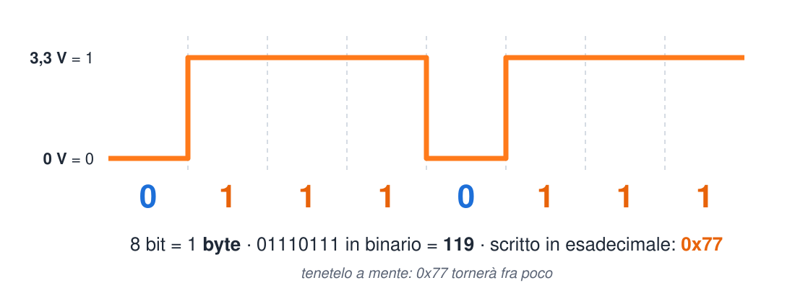

Un pin è **acceso** (3,3 V) o **spento** (0 V): un **bit**. Con 8 bit si scrive un numero da 0 a 255, con tanti bit **qualsiasi cosa**: numeri, testi, colori, foto.

<!--
Dentro il chip non ci sono numeri «veri»: ci sono solo tensioni alte o basse.
Una fila di 8 bit si chiama byte. 01110111 in binario vale 119. I programmatori spesso lo
scrivono in esadecimale, 0x77, perché è più compatto: ogni cifra esadecimale sono 4 bit.
Tenete a mente 0x77: è il «nome» del sensore di pressione, lo ritroviamo fra poco.
-->

---

<!-- _class: fitta -->
<!-- _footer: "Foto: Ubahnverleih, CC0, Wikimedia Commons" -->

# La famiglia ESP32

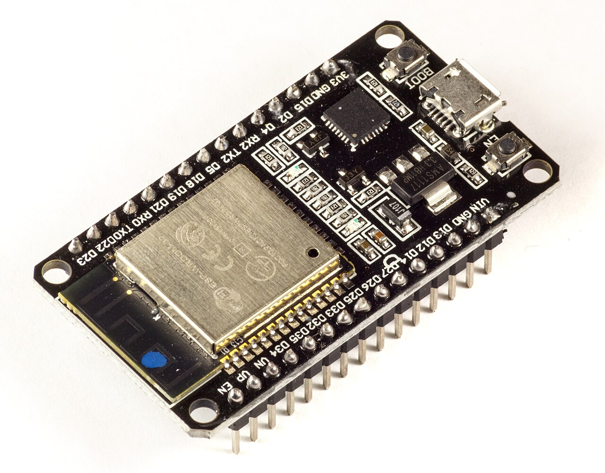

Li produce **Espressif**, un'azienda di Shanghai, dal 2016. La novità: **WiFi e Bluetooth dentro al chip**, a pochi euro. Per questo sono fra i preferiti di chi costruisce progetti.

| Modello | Cosa ha di speciale |
|---|---|
| **ESP32** | il capostipite: 2 core, WiFi e Bluetooth |
| **ESP32-S3** | più potente, istruzioni per l'intelligenza artificiale, USB: **è il nostro** |
| **ESP32-C3 / C6** | piccoli ed economici (il C6 ha il WiFi 6) |
| **ESP32-H2** | per la domotica (Zigbee, Thread), senza WiFi |
| **ESP32-P4** | il più veloce, ma senza radio |

<!--
Prima, nel 2014, Espressif aveva fatto l'ESP8266: il primo chip WiFi così economico da finire
in ogni progetto fai-da-te. L'ESP32 è il suo successore.
Stessa famiglia vuol dire stesso modo di programmarli: quello che si impara su uno vale per gli altri.
-->

---

<!-- _footer: "Foto: Thomas Amberg, CC BY-SA 2.0, Wikimedia Commons (ritagliata)" -->

# La nostra scheda: XIAO ESP32-S3 Sense

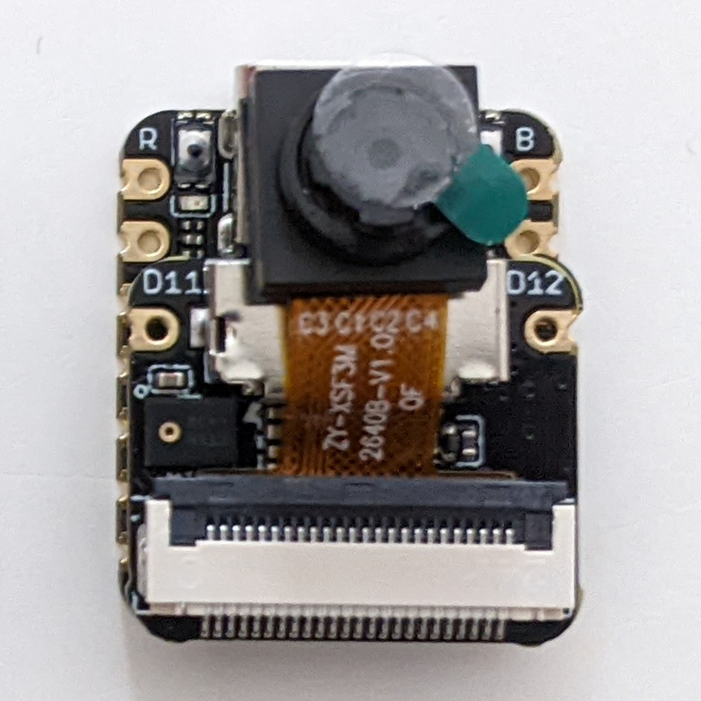

Di **Seeed Studio**: grande come un francobollo (21 × 17,5 mm)

- **2 core a 240 MHz**, 8 MB di memoria
- **WiFi e Bluetooth 5**, con antenna esterna
- **Camera** da 3 megapixel e **microfono**
- Slot per **microSD**: registra tutto
- **Ricarica la batteria** dalla presa USB-C
- 11 pin per collegare il resto

<!--
«Sense» è la versione con la schedina aggiuntiva: camera, microfono e lettore di microSD.
È tutto quello che serve a un registratore di volo, già montato.
Costa sui 20–30 euro. Per un razzo il peso conta: tutta la scheda pesa pochi grammi.
-->

---

<!-- _class: numeri -->

# Quanto è veloce?

- **240 000 000** colpi di orologio al secondo (240 MHz)
- **2 400 000** colpi fra una lettura dei sensori e la successiva
- **100** letture dei sensori al secondo
- **~25** foto al secondo dalla camera

<!--
Il «clock» è un orologio interno che batte 240 milioni di volte al secondo: a ogni battito il
processore fa un passettino. Fra una lettura dei sensori e l'altra (10 millesimi di secondo)
ci sono 2,4 milioni di battiti: tutto il tempo per fare calcoli, scrivere sulla scheda,
gestire il WiFi.
-->

---

<!-- _class: fitta -->

# WiFi e Bluetooth: onde radio


- Il chip parla con **onde radio**: 2,4 miliardi di oscillazioni al secondo (2,4 GHz)
- **Una sola radio**, divisa a turni fra WiFi e Bluetooth
- Il razzo crea **la sua rete WiFi** `WaterRocket`: dal telefono si apre `192.168.4.1` e si vedono video e dati
- L'**antenna** (il rettangolo marrone) sta fuori dal pod, accanto all'obiettivo della camera
- L'**acqua assorbe** queste onde, come nel **forno a microonde**: sulla rampa la bottiglia piena fa da scudo, quindi il pod va girato verso chi controlla il lancio

<!--
2,4 GHz è la banda libera usata da WiFi, Bluetooth, mouse senza fili... e dai forni a
microonde, che scaldano proprio perché l'acqua assorbe bene queste onde.
Per il razzo è un problema pratico: dietro un litro d'acqua il segnale si indebolisce molto.
Non serve internet: è il razzo stesso a fare da «router».
DEMO 8 (firmware-istruzione): le reti WiFi intorno e i loro dBm. Coprire l'antenna con una
bottiglia d'acqua e guardare il numero scendere.
-->

---

<!-- _footer: "Foto: Dicklyon, CC BY-SA 4.0, Wikimedia Commons" -->

# La camera: milioni di sensori di luce

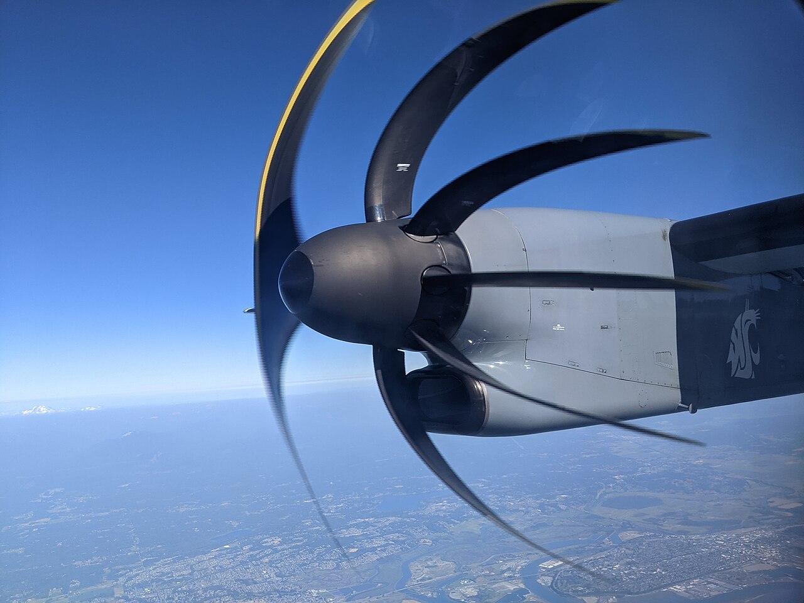

- Sensore **OV3660**: 3 milioni di **pixel**, ognuno misura quanta luce riceve
- In volo: **800 × 600** a **~25 foto al secondo**, salvate sulla microSD
- Il limite non è la camera ma **la velocità della scheda SD**
- Le righe si leggono **una dopo l'altra** (*rolling shutter*): se qualcosa gira veloce si piega, come l'elica nella foto

<!--
Un pixel è una minuscola cella che trasforma la luce in carica elettrica: più luce, più carica.
Il chip legge le celle riga per riga, dall'alto in basso. Se nel frattempo l'immagine si muove,
le righe di sotto vedono una scena diversa da quelle di sopra: ecco le eliche «storte» nei
video fatti col telefono.
La camera vede anche più di 25 foto al secondo, ma scriverle tutte sulla microSD richiede tempo:
è il «collo di bottiglia».
-->

---

<!-- _class: capitolo -->

## 3
# Quanto siamo in alto?

il barometro BMP180

---

<!-- _footer: "Immagine: Library of Congress, pubblico dominio" -->

# L'aria pesa

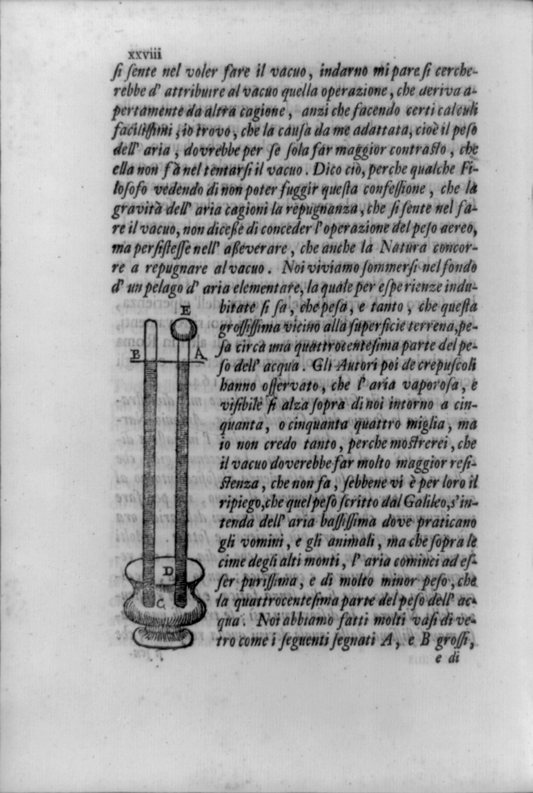

> «Noi viviamo sommersi nel fondo d'un pelago d'aria»
> — Evangelista Torricelli

- **1643**: l'aria regge una colonna di mercurio alta **76&nbsp;cm** (il disegno a destra)
- Oggi si misura in **pascal**: a livello del mare circa **101&nbsp;300&nbsp;Pa**, cioè **1013 hPa**
- Non la sentiamo perché spinge **da tutte le parti**, anche dall'interno del corpo

<!--
La frase è proprio sulla pagina a destra, dalle «Lezioni accademiche» di Torricelli: viviamo
sul fondo di un oceano d'aria, come i pesci sul fondo del mare.
Evangelista Torricelli capovolse in una bacinella un tubo pieno di mercurio: il mercurio scese
fino a 76 centimetri e lì si fermò. Sopra rimase il vuoto. Era l'aria esterna, premendo sulla
bacinella, a reggere la colonna. Questo è il primo barometro.
hPa = ettopascal = 100 pascal. È l'unità delle previsioni del tempo.
-->

---

# Più si sale, meno aria c'è sopra

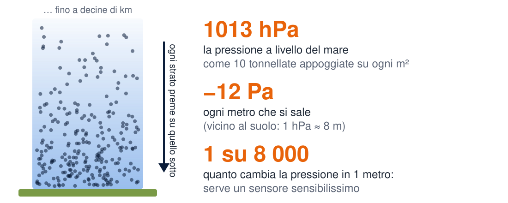

<!--
Più si sale, meno aria resta sopra di noi, e meno pesa. Vicino al suolo, ogni metro in più fa
scendere la pressione di circa 12 pascal.
Il problema: 12 pascal su 101 300 è una parte su 8 000. Per vedere un metro di quota il
sensore deve accorgersi di una variazione di poco più di un decimillesimo. È come accorgersi
di un granello di riso in un sacco da un chilo.
-->

---

# Dentro il BMP180: una membrana che si piega

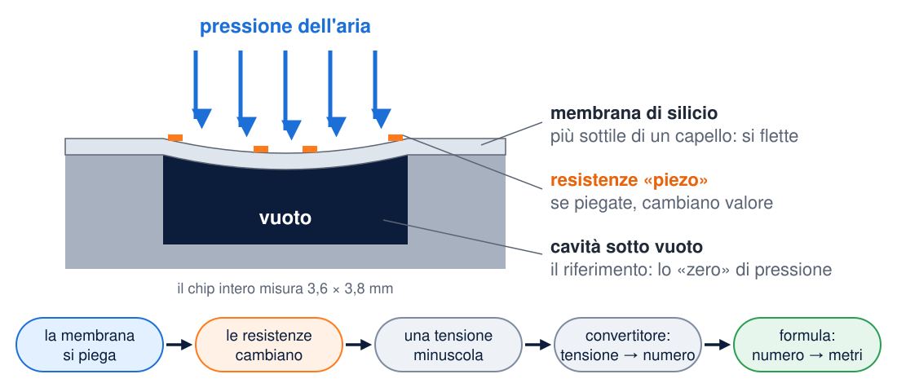

<!--
Il principio: una membrana di silicio sottilissima chiude una piccola cavità sotto vuoto.
Fuori c'è l'aria, dentro il niente: la membrana si flette verso l'interno, tanto più quanto più
l'aria preme.
Sulla membrana sono «stampate» delle resistenze piezoresistive: il silicio, quando viene
stirato o compresso, cambia la sua resistenza elettrica. Così la flessione diventa una
tensione, minuscola; un convertitore analogico-digitale (ADC) la trasforma in un numero;
il programma con una formula la trasforma in metri.
-->

---

<!-- _class: fitta -->
<!-- _footer: "Foto: AGermanBeck, CC BY-SA 4.0, Wikimedia Commons" -->

# Il BMP180 sul razzo

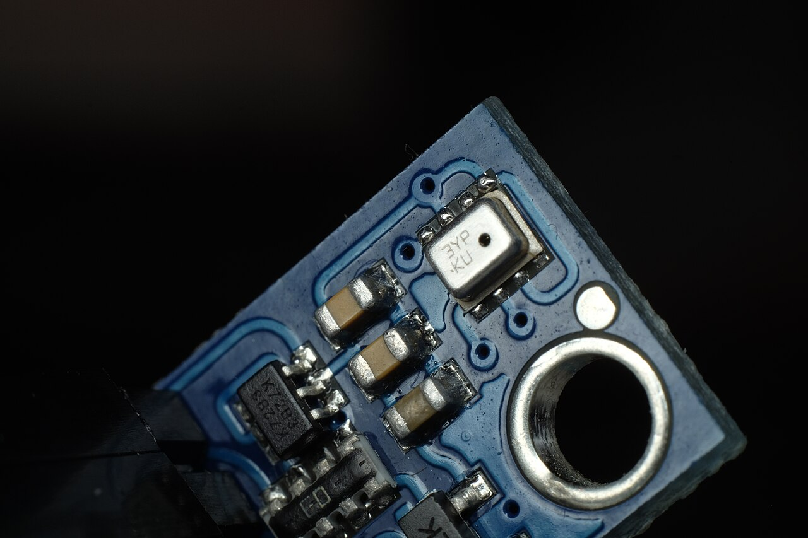

- Chip della **Bosch** su una schedina da pochi euro (nella foto il fratello più giovane, il BMP280: stesso aspetto)
- Misura **pressione** e **temperatura**
- La temperatura serve a **correggere** la pressione: ogni chip ha **11 numeri di taratura** scritti in fabbrica
- Dalla pressione alla quota (non serve ricordarla):

$$h = 44330 \cdot \left(1 - \left(\frac{p}{p_0}\right)^{0{,}19}\right)$$

- $p_0$ è la pressione **sulla rampa**: lì la quota vale **0**

<!--
Nessun sensore è perfetto: due chip della stessa serie non danno lo stesso numero, e il silicio
cambia comportamento col caldo e col freddo. Per questo in fabbrica ogni BMP180 viene misurato
e dentro gli scrivono 11 coefficienti: il programma li legge all'accensione e li usa per
correggere ogni misura.
La formula viene dal modello dell'atmosfera standard. Non misuriamo l'altezza sul mare, ma
quanto siamo saliti rispetto alla rampa: per questo prendiamo come zero la pressione di partenza.
DEMO 2: il chip risponde «chi sei?» (0x55 = BMP180) e stampa i suoi 11 numeri di taratura.
-->

---

# Le misure «ballano»: servono i filtri

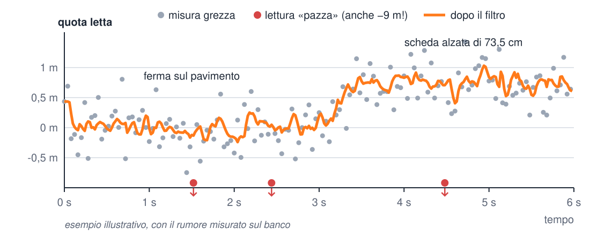

**Mediana**: fra le ultime 5 misure tiene quella di mezzo → le letture pazze spariscono<br>**Media che insegue**: ogni misura nuova sposta il risultato solo di ¼ → il tremolio si calma

<!--
Anche con la scheda ferma la quota letta oscilla di qualche decina di centimetri: è il rumore,
inevitabile in ogni misura. Ogni tanto arriva anche una lettura completamente sbagliata.
Due trucchi, uno dopo l'altro:
1) la mediana: prendo le ultime 5 misure, le metto in ordine e tengo quella in mezzo. Un valore
pazzo finisce in fondo alla fila e non viene mai scelto.
2) la media che insegue: il risultato si avvicina a ogni nuova misura solo di un quarto della
distanza. I salti si smorzano, ma il razzo che sale davvero viene seguito.
Prova vera fatta sul banco: scheda dal pavimento alla scrivania, 73,5 cm; il sensore ha letto 0,71 m.
DEMO 2 dal vivo: alzare la scheda dal pavimento al tavolo. Col tasto g e Teleplot si vedono
quota grezza e filtrata una sopra l'altra, come in questo grafico.
-->

---

# Trappole da ingegneri

- **Il vento finge quota**: a 35 m/s l'aria che sbatte sul sensore vale **6 metri fantasma** → fori di sfiato **sui lati**, mai davanti
- **La luce disturba** il BMP180 → coperto da un pezzetto di spugna, al buio
- **Le dita deformano** la schedina: sul banco la quota saltava di 3–5 m → lo zero si prende **solo a razzo immobile**
- **Il meteo cambia** la pressione durante la giornata → ci si azzera **prima di ogni lancio**

<!--
Queste sono cose che non stanno nei libri: si scoprono provando.
Il vento: l'aria che arriva di fronte viene «schiacciata» e la sua pressione sale; il sensore
pensa di essere più in basso. I razzi veri hanno fori laterali proprio per questo.
La luce: il datasheet della Bosch lo dice, i fotoni disturbano il silicio.
-->

---

<!-- _class: capitolo -->

## 4
# Come parlano i chip

il bus I²C

---

# Tanti sensori, pochi fili

- La XIAO ha solo **11 pin**, e ogni sensore ha **tanti numeri** da dire
- Un filo per ogni dato? Finirebbero subito
- Soluzione: un **bus**, cioè fili **condivisi** da tutti, come una strada con tante fermate
- **I²C** (si legge «i-quadro-ci»): inventato da **Philips nel 1982** per far parlare i chip dentro i televisori. Oggi è in miliardi di oggetti

<!--
I²C sta per Inter-Integrated Circuit: «fra circuiti integrati». Nasce per collegare chip
vicini, sulla stessa scheda, con il minimo dei fili.
-->

---

# Due fili per tutti: SDA e SCL

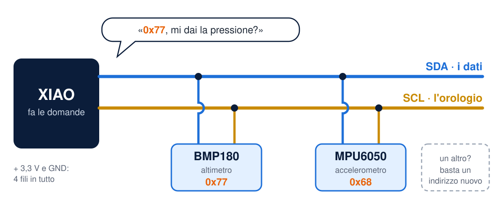

<!--
SDA (Serial DAta) porta i dati, un bit alla volta. SCL (Serial CLock) è l'orologio: dice a
tutti QUANDO leggere il bit.
La XIAO è il «controllore» (una volta si diceva master): è sempre lei a iniziare la
conversazione. I sensori rispondono solo se interpellati.
Come in un'aula: l'insegnante fa l'appello, tutti sentono, ma risponde solo chi è chiamato.
DEMO 1: l'appello vero, da 1 a 127. Rispondono 0x68 e 0x77; staccando un filo, uno sparisce.
-->

---

# Come in classe: si chiama per nome

- Ogni sensore ha un **indirizzo**, deciso dal costruttore
  - BMP180 → **0x77** · MPU6050 → **0x68**
- La XIAO dice l'indirizzo: **tutti ascoltano, risponde solo chi è chiamato**
- Due chip con lo stesso indirizzo? **Rispondono insieme e si fa confusione.** L'orologio DS3231 è 0x68 come l'MPU6050: con un pin si sposta l'MPU6050 a **0x69**
- Dentro ogni sensore ci sono tanti **registri**: cassetti numerati con dentro i dati

<!--
Ecco di nuovo 0x77: è il nome del barometro sul bus.
I registri: immaginate una cassettiera. Il cassetto 0x3B dell'MPU6050 contiene l'accelerazione
lungo X, il 0x75 contiene il «nome» del chip (WHO_AM_I) che serve a riconoscerlo.
Per leggere, la XIAO prima dice «voglio il cassetto tal dei tali», poi chiede i byte.
-->

---

# Un bit a ogni colpo di orologio

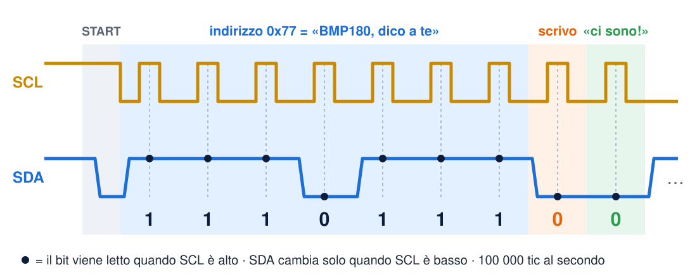

<!--
Leggiamo insieme il disegno da sinistra:
1) START: SDA scende mentre SCL è alto. È il «attenzione!» che tutti riconoscono.
2) La XIAO scrive 7 bit di indirizzo: 1110111 = 0x77. A ogni impulso di SCL il bit su SDA viene letto.
3) Un bit dice se vuole scrivere (0) o leggere (1).
4) ACK: la XIAO lascia libero il filo e il sensore lo tira a 0: «presente!». Se nessuno
risponde, il filo resta a 1 e la XIAO sa che quel sensore non c'è (o è collegato male).
A 100 kHz l'orologio batte 100 000 volte al secondo.
-->

---

# Il trucco: nessuno spinge, tutti tirano giù

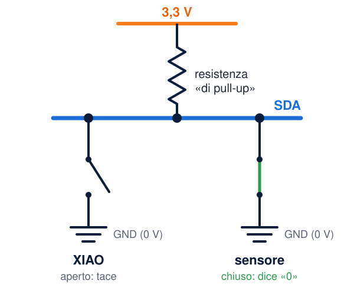

- Una **resistenza** tiene il filo a **1** quando nessuno parla
- Chi vuole dire **0** collega il filo a **massa** (0&nbsp;V)
- Nessuno può «spingere» a 1 → se due parlano insieme **non si rompe niente**
- L'errore più comune nel montaggio? **SDA e SCL invertiti**. Il nostro programma se ne accorge e lo scrive!

<!--
Si chiama «open drain» con resistenza di pull-up. Pensate a una porta con una molla che la
tiene chiusa: chiunque può aprirla tirando, nessuno la spinge. Se in due tirano insieme, non
succede niente di male.
Se invece un chip spingesse a 3,3 V e un altro tirasse a 0 V nello stesso istante, sarebbe un
corto circuito.
Nel nostro firmware: se nessun sensore risponde, il programma prova a scambiare SDA e SCL; se
così risponde, stampa «i fili di D4 e D5 sono invertiti».
-->

---

<!-- _class: fitta -->

# Una conversazione vera, 100 volte al secondo

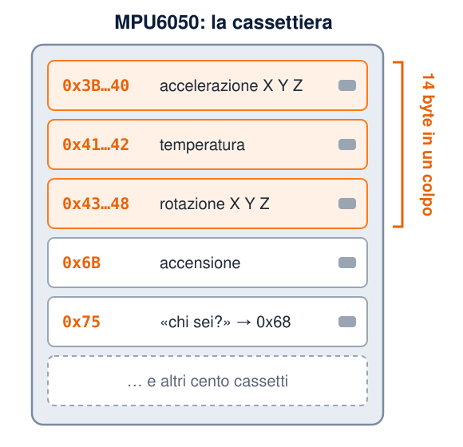

1. XIAO: «**0x68**, voglio leggere dal cassetto **0x3B**»
2. MPU6050: «ecco **14 byte**»: accelerazione X Y Z, temperatura, rotazione X Y Z
3. XIAO: «**0x77**, dammi la pressione» → BMP180: «ecco **3 byte**»
4. …e da capo, ogni **10 millesimi di secondo**

Il giro completo dura **circa 2 ms**: resta tempo per tutto il resto.

<!--
14 byte = 7 numeri da 2 byte ciascuno (16 bit, da −32 768 a +32 767). Il programma li divide
per la scala del sensore e ottiene g e gradi al secondo.
Il BMP180 è più lento: gli si chiede di misurare, lui ci mette qualche millisecondo, e il
risultato si ritira al giro dopo. Così nessuno resta ad aspettare.
DEMO 3: mostrare mpuLeggi() in firmware-istruzione/src/mpu6050.cpp. Sono esattamente le
righe 1 e 2 di questa slide, scritte in C++.
-->

---

<!-- _class: capitolo -->

## 5
# Come si muove?

accelerometro e giroscopio MPU6050

---

<!-- _footer: "Foto: Nevit Dilmen, CC BY-SA 3.0, Wikimedia Commons" -->

# Accelerazione: quanto cambia la velocità

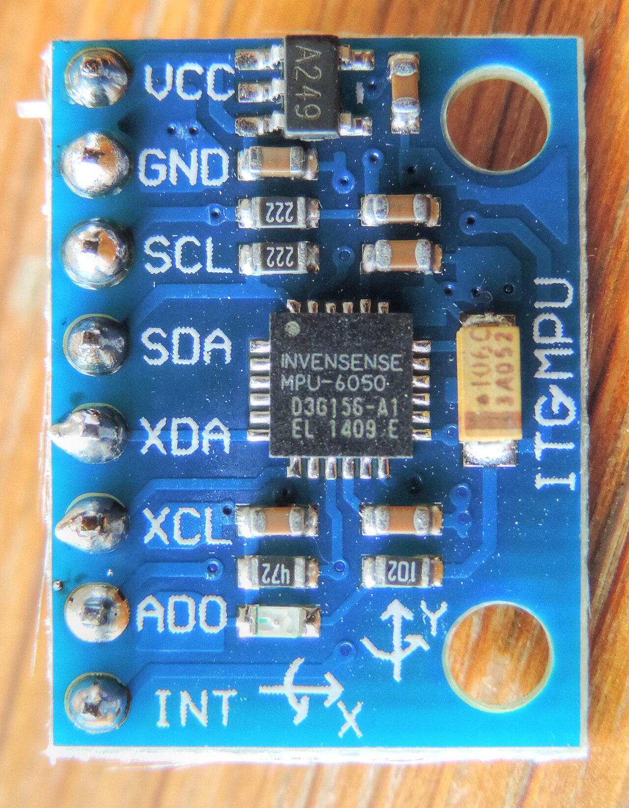

- Si misura in **g**: 1 g è l'accelerazione con cui cadono le cose (9,8 m/s²)
- Il telefono la usa per **girare lo schermo** e contare i passi
- Sorpresa: **fermo sul tavolo** l'accelerometro legge **1 g**, verso l'alto
- In **caduta libera** legge **0 g**: è quello che «sentono» gli astronauti

<!--
Accelerare vuol dire cambiare velocità: partire, frenare, curvare.
Perché fermo legge 1 g? Il sensore non sente la gravità in sé, sente la forza del tavolo che
lo spinge in su e gli impedisce di cadere. In caduta libera quella forza sparisce: 0 g.
Sul razzo: sulla rampa 1 g, al decollo decine di g, dopo lo spegnimento del «motore» quasi 0.
DEMO 3: piatta sul tavolo Z = 1 g, capovolta −1 g, in caduta su un cuscino 0 g.
-->

---

# Dentro il chip: una massa appesa a molle

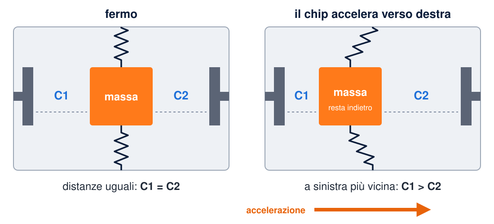

<!--
Il principio è lo stesso di quando in macchina, in accelerazione, venite schiacciati contro il
sedile: il corpo «resta indietro».
Nel chip c'è una massa di silicio sospesa a molle. Accanto ci sono piastre fisse. Massa e piastra
formano un condensatore: la sua «capacità» dipende dalla distanza. Quando il chip accelera la
massa resta un po' indietro, una distanza diminuisce e l'altra aumenta: il chip misura la
differenza e la trasforma in un numero.
-->

---

<!-- _footer: "SEM: Nguyen et al., Micromachines 2017, CC BY 4.0, Wikimedia Commons (ritagliata)" -->

# MEMS: macchine microscopiche

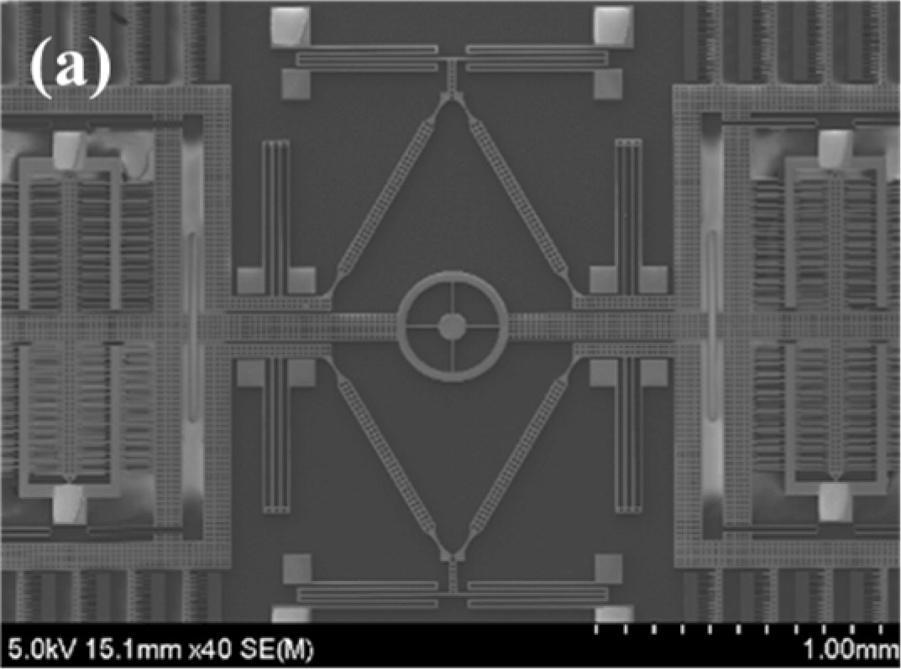

- **MEMS** = micro-macchine scolpite nel silicio, come i chip
- Molle e masse di **pochi millesimi di millimetro**
- Cambia la distanza → cambia la **capacità** (quanto due piastre «si sentono») → un numero
- Nella foto, al microscopio elettronico: un **giroscopio** MEMS largo circa 1 mm, con i «pettini» ai lati

<!--
MEMS = Micro Electro-Mechanical Systems. Sono vere macchine con parti mobili, ma talmente
piccole che si vedono solo al microscopio elettronico, come in questa foto (è un giroscopio di
ricerca, non quello del nostro chip, ma la tecnica è la stessa). I «pettini» sono le piastre:
tanti denti affacciati che aumentano la superficie, e quindi il segnale.
Ci sono nei telefoni, negli airbag, nei controller dei videogiochi.
Gli airbag sono stati una delle prime applicazioni di massa: un accelerometro MEMS capisce in
pochi millesimi di secondo che c'è stato un urto.
-->

---

# Tre assi e un giroscopio

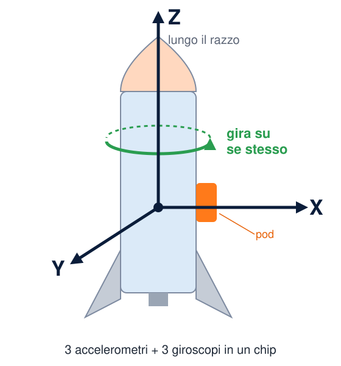

- **Accelerometro**: spinte e frenate lungo **X, Y, Z**
- **Giroscopio**: quanto velocemente il razzo **gira**, in gradi al secondo
  - dentro, una massa che **vibra**: se il chip ruota, viene spinta di lato (effetto **Coriolis**, come quando si cammina su una giostra)
- Il nostro arriva fino a **2000 °/s**: più di 5 giri al secondo

<!--
L'MPU6050 contiene 6 sensori: 3 accelerometri (uno per direzione) e 3 giroscopi.
Effetto Coriolis: se camminate verso il centro di una giostra che gira, sentite una spinta di
lato. La massa del giroscopio fa avanti e indietro migliaia di volte al secondo: se il chip
ruota, la spinta laterale la sposta e il chip la misura.
Un razzo con le pinne un po' storte gira su se stesso come una trottola: il giroscopio ce lo dice.
DEMO 4: girare la scheda di 90° sul tavolo e leggere l'angolo. Poi lasciarla ferma: l'angolo
scivola piano piano (la deriva), per questo il razzo si ritara prima di ogni lancio.
-->

---

# Ogni sensore ha un limite

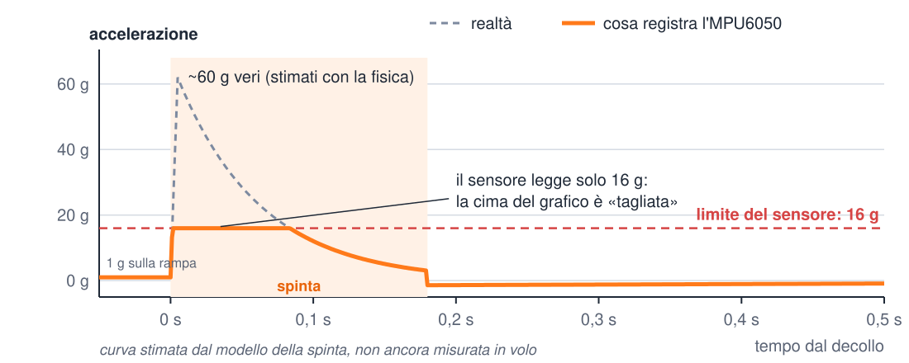

L'MPU6050 arriva al massimo a **16 g**, ma al decollo il razzo ne fa circa 60: la cima del grafico viene **tagliata**. Non è un guasto, è il **fondo scala**.

<!--
È come una bilancia pesapersone su cui sale un elefante: segna il massimo e basta.
Allora come si ricostruisce la spinta vera? Si usa il barometro: sappiamo quanto dura la spinta
(dove il grafico si appiattisce) e con quale velocità il razzo esce, da quanto in alto arriva.
Velocità diviso tempo = accelerazione media. Misure diverse che si controllano a vicenda.
Esistono accelerometri da 200 o 400 g, ma costano 10 volte tanto.
-->

---

# Come capisce che è partito? Con delle regole

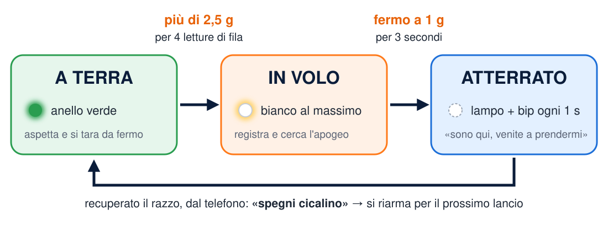

Questo è **programmare**: trasformare un'idea («è partito!») in **regole precise** che il chip controlla 100 volte al secondo.

<!--
Si chiama «macchina a stati»: il razzo è sempre in uno di tre stati, e passa all'altro solo
quando una condizione è vera.
Perché «per 4 letture di fila» e non basta una? Perché un urto, o la mano che appoggia il razzo
sulla rampa, può dare un picco per un istante. Quattro letture di fila sopra i 2,5 g (30 ms)
le dà solo un decollo vero.
E perché atterrato = fermo a 1 g per 3 secondi? Perché a terra il razzo può rimbalzare e
rotolare: aspettiamo che sia davvero immobile.
Questa logica sta in poche righe di codice: il difficile non è scriverla, è sceglierle bene.
DEMO 0: la stessa macchina a stati (demo_0_decollo.cpp, uno switch con tre casi), con soglie
da mano. Domanda: perché sul razzo le soglie sono più alte?
-->

---

# Prima del lancio: la taratura

- Da fermo l'accelerometro dovrebbe leggere **esattamente 1 g** e il giroscopio **0**: non succede mai
- Il razzo **si tara da solo** quando resta immobile sulla rampa per **3 secondi**:
  - impara **dov'è il basso** (la direzione della gravità)
  - prende la **quota zero** dal barometro
- Anello **blu** che respira, poi **2 bip corti**: pronto
- Se qualcuno lo tocca mentre si tara, **ricomincia** da capo

<!--
Ogni sensore ha piccoli errori di fabbrica: un giroscopio fermo può dire 1,5 gradi al secondo.
Se non lo correggiamo, in 10 secondi il razzo «crederebbe» di aver ruotato di 15 gradi.
La taratura misura questi errori da fermo e poi li sottrae a ogni lettura.
-->

---

<!-- _class: capitolo -->

## 6
# Farsi trovare

cicalino e anello LED

---

# Il cicalino: una calamita a intermittenza

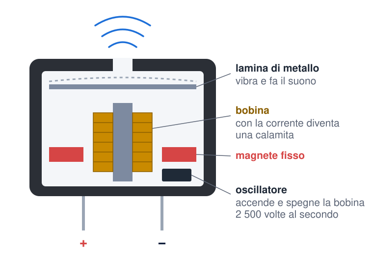

- Corrente nella **bobina**: diventa una **calamita** e attira la **lamina**
- Corrente spenta: la lamina **torna indietro**
- **2 500 volte al secondo** → un fischio a **2,5 kHz**
- L'orecchio umano è **molto sensibile** fra 2 e 5 kHz

<!--
Una bobina è un filo avvolto tante volte: quando ci passa corrente diventa un elettromagnete.
L'oscillatore interno la accende e la spegne 2 500 volte al secondo: la lamina vibra e spinge
l'aria avanti e indietro. Quelle spinte sono il suono.
2,5 kHz non è scelto a caso: è una delle frequenze che sentiamo meglio e che riusciamo a
localizzare meglio, cioè capire da dove arriva.
DEMO 5: «pin D1 = 1 → suona, pin D1 = 0 → silenzio», scritto in diretta.
-->

---

<!-- _class: fitta -->
<!-- _footer: "Foto: jdx, CC BY-SA 3.0, Wikimedia Commons" -->

# Attivo o passivo?

| | **Attivo** (il nostro) | Passivo |
|---|---|---|
| Come si comanda | **1 bit**: acceso o spento | un'onda: acceso/spento velocissimo |
| Suono | una nota fissa | qualsiasi nota: anche melodie |
| Se il programma si blocca col suono acceso | **continua a suonare** | tace |

- Suona **200 ms ogni secondo**, non di continuo: un suono a intermittenza si **localizza** meglio e consuma 5 volte meno

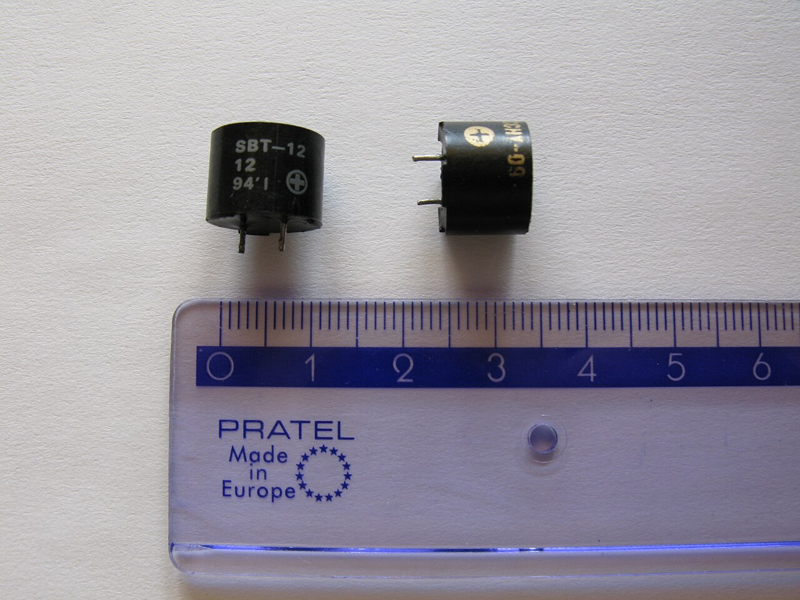

<!--
Il cicalino attivo ha l'oscillatore dentro: per il microcontrollore è come accendere una lampadina,
un solo pin, 0 o 1. È la comunicazione più semplice che esista.
Il passivo invece è un altoparlantino «nudo»: la nota la deve creare il programma, accendendo e
spegnendo il pin 2 500 volte al secondo.
Per il ritrovamento vince l'attivo: dopo un atterraggio violento il programma potrebbe essersi
bloccato, ma se il pin è rimasto acceso il fischio continua.
-->

---

<!-- _footer: "Foto: John McMaster, CC BY 4.0, Wikimedia Commons" -->

# LED: luce dai semiconduttori

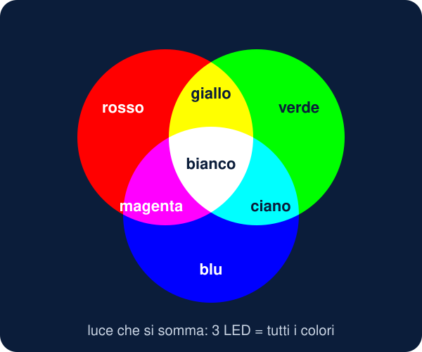
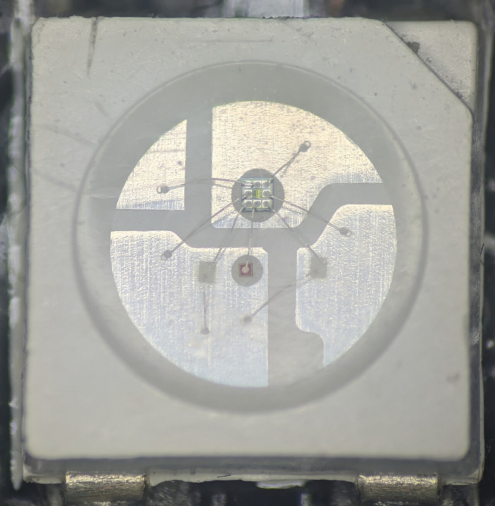

- Un **LED** fa luce quando ci passa corrente, scaldando pochissimo
- Il colore dipende dal **materiale**: rosso, verde, blu…
- Tre LED **vicinissimi** (rosso, verde, blu), ognuno regolato da 0 a 255: **16,7 milioni** di colori
- È lo stesso trucco dei **pixel** dello schermo che state guardando
- Sotto: un nostro LED visto da vicino, con i 3 colori e **un chip**

<!--
In un LED gli elettroni, attraversando il materiale, «cadono» da un livello di energia a uno
più basso e liberano un fotone. Il salto di energia, deciso dal materiale, decide il colore.
Mescolare luce non è come mescolare tempere: con la luce rosso + verde fa giallo, e tutti e tre
insieme fanno bianco (sintesi additiva).
256 × 256 × 256 = 16 777 216 combinazioni.
-->

---

# WS2812B: un LED con un chip dentro

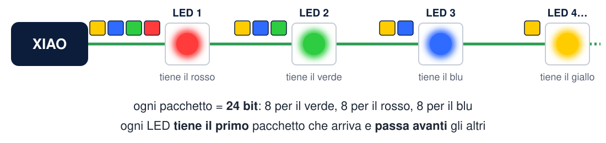

Bastano **3 fili** per 8 LED (o per mille): alimentazione, massa e **un solo filo di dati**.

<!--
Ogni LED del nostro anello contiene un minuscolo chip di controllo. La XIAO spedisce una fila di
pacchetti da 24 bit (8 per colore). Il primo LED tiene il primo pacchetto e rimanda gli altri
al secondo, che tiene il suo e passa il resto, e così via.
Come in una fila di persone che si passano un mazzo di carte: ognuno prende quella in cima.
DEMO 6: per ogni colore stampa i 24 bit che partono sul filo, poi accende un LED alla volta.
-->

---

# Un filo solo, senza orologio: conta quanto dura

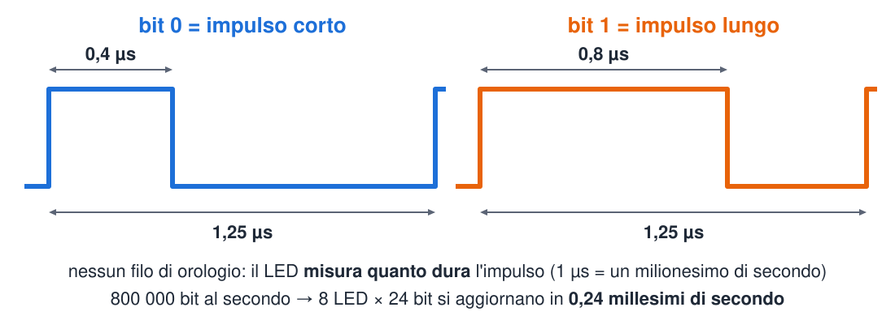

<!--
Nell'I²C c'era un filo apposta per l'orologio. Qui no: c'è un solo filo, e il LED distingue
0 e 1 dalla durata dell'impulso. Un impulso corto è uno 0, uno lungo è un 1.
Servono tempi precisissimi, al decimo di milionesimo di secondo: l'ESP32 ha una periferica
apposta (si chiama RMT) che genera questi impulsi da sola, mentre il processore fa altro.
-->

---

<!-- _class: fitta -->

# Cosa ci dicono luce e suono

| Momento | Anello LED | Cicalino |
|---|---|---|
| Acceso, sensori a posto | verde, piano | 1 bip corto |
| Errore (manca la microSD, sensore muto) | rosso fisso | 3 bip lunghi |
| Taratura sulla rampa (3 s) | blu che respira | 2 bip corti = ok, 1 lungo = rifare |
| Registrazione in corso | rosso che pulsa | — |
| In volo | **bianco al massimo** | — |
| Atterrato | **lampo bianco** ogni secondo | **bip** ogni secondo, insieme al lampo |

<!--
Senza schermo, luce e suono sono l'«interfaccia utente» del razzo. Sul campo, al sole, con il
telefono in tasca, un colore e un numero di bip bastano a capire se si può lanciare.
Il lampo bianco e il bip vanno insieme fino a quando, ritrovato il razzo, li si spegne dal telefono.
-->

---

<!-- _class: capitolo -->

## 7
# Tutto insieme

dal sensore al grafico sul telefono

---

# Il sistema completo

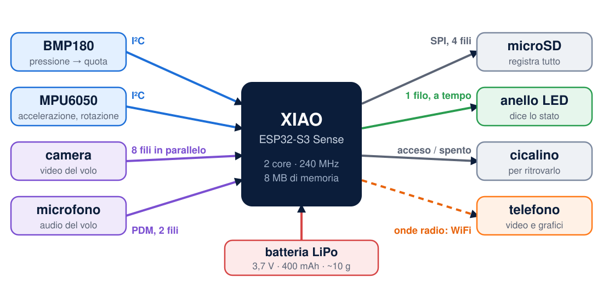

<!--
Riassunto visivo: a sinistra quello che il razzo «sente», a destra quello che fa. In mezzo il
cervello. Sotto, la batteria da 400 mAh: basta per più di un'ora, decine di lanci.
Notate le etichette sulle frecce: ogni componente parla una lingua diversa.
DEMO 9, la livella: accelerometro e anello insieme. Sento, decido, agisco: la luce rotola
verso il basso quando si inclina la scheda.
-->

---

<!-- _class: fitta -->

# Tanti modi di parlare

| Come | Fili | Velocità | Nel razzo |
|---|---|---|---|
| **Acceso / spento** | 1 | — | cicalino |
| **Un filo, a tempo** | 1 | 800 000 bit/s | anello LED |
| **I²C** | 2 | 100 000 bit/s | barometro, accelerometro |
| **PDM** | 2 | ~1 milione di bit/s | microfono |
| **SPI** | 4 | decine di milioni di bit/s | microSD |
| **Parallelo** | 8 + orologi | milioni di byte/s | camera |
| **WiFi** | nessuno: onde radio | decine di milioni di bit/s | telefono |

Più fili = più veloce, ma meno pin liberi. Ogni scelta è un **compromesso**.

<!--
Questa è la vera lezione sulla comunicazione: non esiste il modo migliore in assoluto.
Per un cicalino basta un bit. Per due sensori lenti l'I²C è perfetto: due fili per tutti.
La camera manda milioni di byte al secondo e ha bisogno di otto fili in parallelo.
Il WiFi non ha fili, ma consuma molta più energia.
-->

---

<!-- _class: numeri -->

# Un secondo di volo, per la XIAO

- **100** letture di accelerazione, rotazione e pressione
- **~25** foto della camera
- **16 000** campioni di audio
- **2** core al lavoro insieme: uno per camera e audio, uno per i sensori

<!--
Tutto finisce sulla microSD, in una cartella per ogni lancio: video, audio e una tabella
(sensors.csv) con una riga ogni centesimo di secondo.
Due core: è come avere due cuochi nella stessa cucina. Uno si occupa della camera e del
microfono, che producono tantissimi dati; l'altro dei sensori, che vanno letti con tempi
precisissimi. Così l'uno non rallenta l'altro.
DEMO 7: il microfono. Ogni decimo di secondo 1600 numeri diventano un volume in decibel:
battere le mani e guardare la barra.
-->

---

# Dal razzo al telefono

- Ci si collega alla rete WiFi **WaterRocket** del razzo
- Nel browser: elenco dei lanci, **video con audio**, rallentatore fino a **0,1×**
- I dati dei sensori diventano **grafici sincronizzati col video**
- Si scarica tutto (video, tabelle CSV) per studiarlo con un foglio di calcolo
- Nessuna app da installare e **nessun internet**: la pagina web vive dentro il chip

<!--
Suggerimento: qui sta bene uno screenshot della pagina del lancio, o una dimostrazione dal vivo
con la scheda accesa e il telefono collegato alla rete WaterRocket.
La pagina web è un file HTML salvato nella memoria della XIAO: il chip fa da server web, come
un sito internet in miniatura.
-->

---

# Cosa ci aspettiamo di vedere

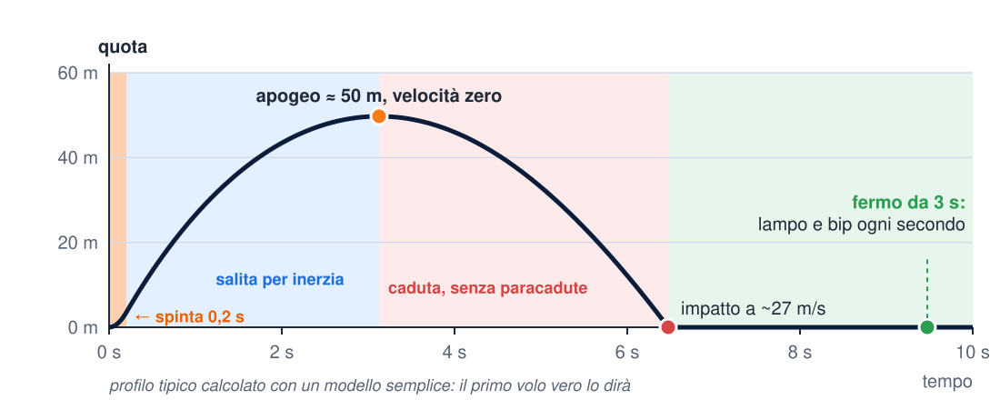

<!--
Questo è il profilo atteso, calcolato con un modello semplice: 0,2 secondi di spinta, poi il
razzo sale per inerzia rallentando e a circa 3 secondi arriva in cima. Non c'è paracadute:
ricade, frenato solo dall'aria, e dopo circa 6,5 secondi tocca terra a circa 27 metri al
secondo. Poi rimbalza, rotola, si ferma: dopo 3 secondi di immobilità il programma lo dà per
atterrato e parte il ritrovamento.
Il bello di avere i sensori a bordo: dopo il lancio sovrapponiamo la curva vera a questa e
vediamo dove il modello sbaglia. È esattamente così che lavorano gli ingegneri.
-->

---

# Cosa ci ha insegnato (finora)

- **Ogni sensore sbaglia un po'**: rumore, limiti, disturbi. Si filtra e si controlla
- **Si prova a terra prima di volare**: alzare la scheda di 73,5 cm e vedere se legge 0,71 m
- **Si progetta pensando ai guasti**: senza paracadute l'arrivo a terra è violento, quindi il cicalino suona anche col programma bloccato e i dati si salvano ogni secondo
- **Un problema alla volta**: un sensore, un filo, una prova

<!--
Queste regole valgono per qualsiasi progetto, non solo per i razzi.
La maggior parte del tempo non è andata a scrivere codice nuovo, ma a capire perché una misura
era strana: un filo, un sensore illuminato, una mano sulla schedina.
-->

---

<!-- _class: fitta -->
<!-- _footer: "Foto: MakeMagazinDE, CC BY-SA 4.0, Wikimedia Commons" -->

# Volete provarci? Si parte con poco

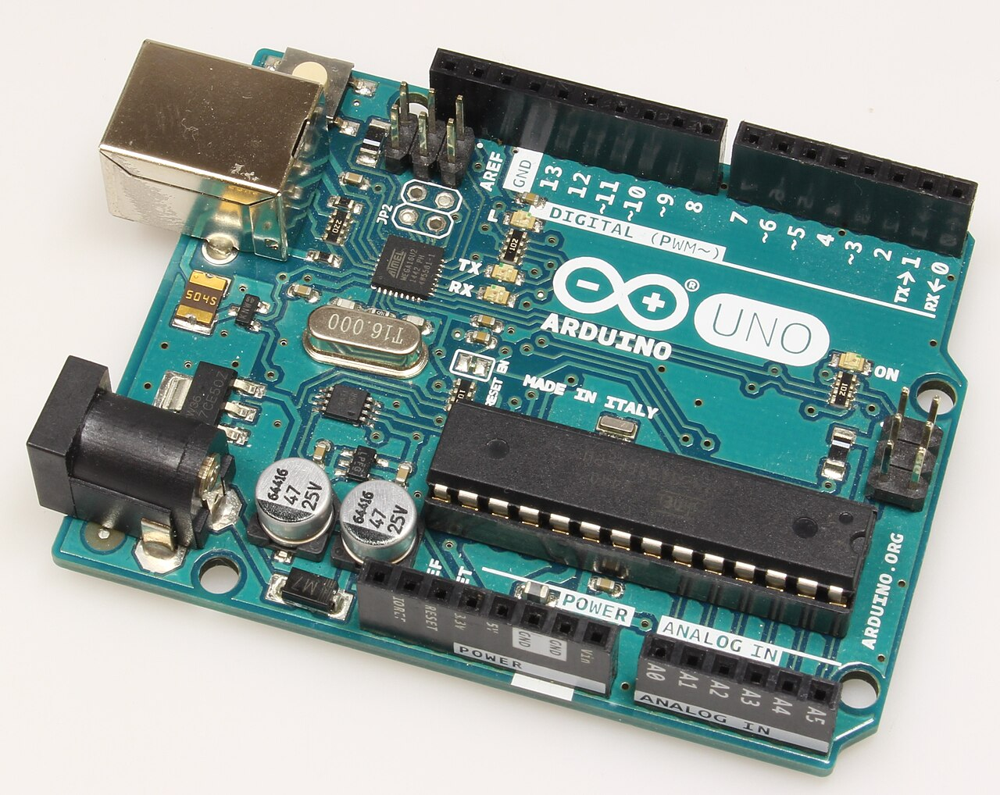

- Una scheda **ESP32** o **XIAO**: 5–25 €
- Un programma gratuito: **Arduino IDE** (oppure VS Code con PlatformIO)
- Una breadboard, qualche filo, un LED, un sensore di pressione **BMP280** (~2 €)
- Il primo programma di tutti: **far lampeggiare un LED**

```cpp
void loop() {               // ripeti all'infinito:
  digitalWrite(LED, HIGH);  //   accendi (pin a 1)
  delay(500);               //   aspetta mezzo secondo
  digitalWrite(LED, LOW);   //   spegni (pin a 0)
  delay(500);               //   aspetta ancora
}
```

<!--
È lo stesso ciclo «sento, decido, agisco» visto all'inizio, nella sua forma più semplice: qui
si agisce soltanto. Da qui al razzo ci sono solo tanti piccoli passi uguali a questo.
-->

---

<!-- _class: lead -->
<!-- _paginate: false -->

# Grazie!<br>**Domande?**

### Tutto il progetto (documenti, firmware, modelli 3D) è libero su GitHub

**github.com/daniele96/WaterRocket**

<!--
Lasciare questa slide durante le domande.
-->

---

<!-- _class: crediti -->
<!-- _paginate: false -->
<!-- _footer: "" -->

# Crediti delle immagini

Schemi e grafici: disegnati per questa presentazione. Modelli 3D della cintura: progetto WaterRocket. Foto da **Wikimedia Commons**, con licenza libera (dettagli e link in `img/foto/CREDITS.md`):

| Soggetto | Autore | Licenza |
|---|---|---|
| Razzo ad acqua al decollo | Xorx | CC BY-SA 4.0 |
| Scheda di una lavatrice · TMS1000 | Phiarc · Antonio Martí Campoy | CC BY-SA 4.0 |
| Scheda ESP32 | Ubahnverleih | CC0 |
| XIAO ESP32S3 Sense (ritagliata) | Thomas Amberg | CC BY-SA 2.0 |
| Elica e rolling shutter | Dicklyon | CC BY-SA 4.0 |
| Pagina delle «Lezioni accademiche» di Torricelli | Library of Congress | pubblico dominio |
| Modulo BMP280 | AGermanBeck | CC BY-SA 4.0 |
| Modulo GY-521 (MPU6050) | Nevit Dilmen | CC BY-SA 3.0 |
| Giroscopio MEMS al SEM (ritagliata) | M. N. Nguyen et al., *Micromachines* 2017 | CC BY 4.0 |
| Buzzer elettromagnetici | jdx | CC BY-SA 3.0 |
| LED WS2812B da vicino | John McMaster | CC BY 4.0 |
| Arduino Uno R3 | MakeMagazinDE | CC BY-SA 4.0 |
